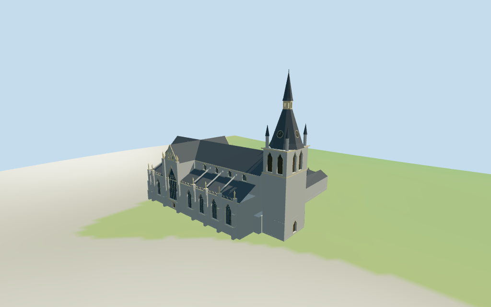

# Liège Cathedral

Individual Liège Saint-Paul Cathedral:gray Gothic nave and polygonal eastern choir,projecting transept gables,tall recessed pointed windows/cream geometric tracery,step buttresses/pinnacles,western paired-louver tower with clock,corner turrets,tapered slate spire and actual open upper lantern. Lower slate cloister ranges surround the retained open garth,with small dormers and stair turret. Four browser levels and four existing shared256-square graphs. Heights,hidden roof partitions,full interiors,fine sculpture/crockets and exact host-ground contact remain approximate or excluded.

## Evidence and reconstruction

Published dimensions and reconstructed details are separated in spec.json. Primary references:

- [Reference](https://commons.wikimedia.org/wiki/File:St_Paul_Liege_Exterior.JPG)
- [Reference](https://commons.wikimedia.org/wiki/File:Li%C3%A8ge_Clo%C3%AEtre_Saint-Paul_R08.jpg)
- [Reference](https://commons.wikimedia.org/wiki/File:Li%C3%A8ge_Clo%C3%AEtre_Saint-Paul_R14.jpg)

Four existing cached256-square ashlar,continuous limestone,slate and plain wood graphs.Linear gray-stone/cream-tracery/slate tints,metric UVs,flat normals,six merged groups.No embedded images,unique facade maps or baked lighting.

## Model and axes

20,815 triangles; 62,445 vertices; 6 material groups; 2,501,432 bytes. Native bounds: -44.232, -0.837, -39.980 to 43.266, 62.650, 37.937. Source hash: `sha256:76f97a1f409608c7bd245c087efdf87c3e3316fb515798bc0e1febb623861545`.

{"x":"east-northeast toward polygonal choir","y":"up","z":"south-southeast toward cloister court"}

Standard viewer DEM datum70.393040m,estimated floor0.65m,raw compound perimeter-0.49..0.78m. Footings crossY=0 and extend below samples. Court stays genuinely open in geometry;viewer footprint must retain its central core. No preview flattening,host DEM change or road replacement. Exact pavement/door joins,base clipping,absolute altitude and walking remain unverified. Surrounding shops,modern buildings,roads,garden plants and site furniture stay host content.

## Reproduce

Run `node packages/worldgen/scripts/generate-additional-landmarks.mjs --ids=liege_cathedral` (or add `--check`). The generator preserves manually edited masters by checking their baseline hashes. Import through the standard authored-model workflow with optimization disabled; then capture all QA cameras, including shared-surface views.

## Pending work

- Retained exact-QID relation/2295569/Q1573417 matches current compound52776560428817. Current32 outer and6 court vertices retain all38 raw points/tags; earlier36 distinct outer/6 court vertices and multilingual tags/facts remain intact. No current height tag or retained height fact. Retained37m width/110m length facts have no reference URLs and differ from current86.35x75.9m compound including cloister;no forced rescale. Retained heading0.293601642088rad signs+X east-northeast polygonal choir,+Z south-southeast cloister;west spire at-X. All partitions/heights are picture-led estimates above0.65m floor:aisle14.5m,sloping roof19m,nave/transept eave23m/ridge31m,west tower34m/shoulder36m,clock on lower steep spire,open lantern48..51m and upper spire/finial62m. Approximate proportions,not surveyed dimensions.
- Standard viewer DEM datum70.393040m,estimated floor0.65m,raw compound perimeter-0.49..0.78m. Footings crossY=0 and extend below samples. Court stays genuinely open in geometry;viewer footprint must retain its central core. No preview flattening,host DEM change or road replacement. Exact pavement/door joins,base clipping,absolute altitude and walking remain unverified. Surrounding shops,modern buildings,roads,garden plants and site furniture stay host content.
- Medium-fi exterior from three actually inspected2013/2023 north and south-cloister photographs plus standard viewer PMTiles/DEM.No bespoke plans/surveys.Masonry/window rhythms,spire proportions and hidden roof partitions approximate.Fine sculpture,crockets,exact stained-glass art/clock lettering,full interiors and engineering accuracy excluded.Physical laptop/phone timing pending.
- Skyline preserves roof hierarchy,tower/open lantern and court opening.District adds shared textures,recessed selected Gothic windows/doors,tower louvers,corner turrets and buttress/flying struts.Street adds more choir/clerestory/cloister windows,mullions,louver slats,dormers and parapet rhythms.Closeup/master add simple geometric foils/transoms,nested transept trim and smaller parapet elements.Regional context is a fixture.

This bundle follows the medium-fi standard. Medium-fi appearance and geographic fit are reviewed separately. Hash-bound visual acceptance is recorded separately after capture inspection.

## Additional geographic data

©OpenStreetMap contributors;Protomaps;Mapzen/USGS terrain tiles.
