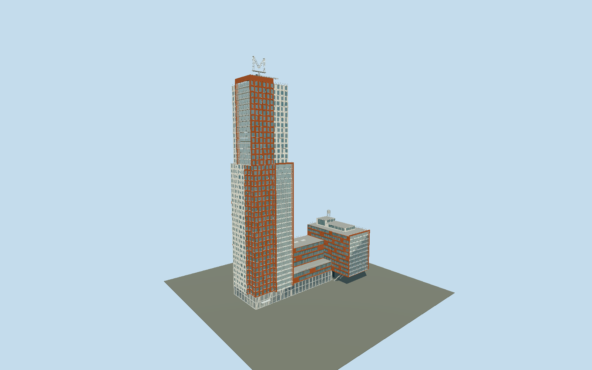

# Montevideo

Rotterdam’s Montevideo: offset brick and pale tower volumes, an upper fifteen-level glazed balcony frame, lower circular windows, a stepped connecting block, the braced quay cantilever, rooftop water-tank sculpture and open lattice M weather vane.

## Evidence and reconstruction

Published dimensions and reconstructed details are separated in spec.json. Primary references:

- [Reference](https://www.mecanoo.nl/Projects/project/33/Montevideo-Residential-Tower?yr=0)
- [Reference](https://www.mecanoo.nl/News/ID/142/M-for-Rotterdam--10-years-of-Montevideo)
- [Reference](https://abt.eu/en/projects/montevideo/)
- [Reference](https://www.besix.com/en/projects/montevideo-tower)
- [Reference](https://vaneerdenconstructieadvies.nl/wp-content/uploads/2021/02/Montevideo-BMS.pdf)
- [Reference](https://www.skyscrapercenter.com/building/montevideo/5382)
- [Reference](https://api.3dbag.nl/collections/pand/items/NL.IMBAG.Pand.0599100000750601)
- [Reference](https://docs.3dbag.nl/en/copyright/)
- [Reference](https://www.openstreetmap.org/way/26545811)

No third-party geometry, photograph or bitmap texture is embedded. Shared surface graphs come from the central library; vertex tints carry model colors. Glazing uses PBR materials; transparent surfaces are declared per model.

## Model and axes

493,066 triangles; 982,340 vertices; 7 material groups; 41,285,012 bytes. Native bounds: -46.085, 0.000, -21.985 to 46.000, 152.317, 21.960. Source hash: `sha256:d365a61e61ea34c6f76106693ec211d4f6f878dd86d07f1ffaecfac3b0613c95`.

{"up":"+Y","longitudinal":"+X northeast along the quay","front":"+Z southeast toward the water","origin":"BAG plan envelope center; Y0 is terrain contact. Native+X east-northeast follows the AntoinePlatekade edge and native+Z south-southeast faces the Rijnhaven. Actual north-up Google satellite viewed2026-10-09 shows tall tower at the southwest negative-X end, lower projecting wing at the northeast positive-X end, terraces between and quay on the southeast. Architect river overview and cantilever photograph independently show that signed arrangement. The glass-fronted low-wing cantilever remains open below over the pedestrian quay; the BAG perimeter is an upper-volume projection, not a ground solid. RD-to-WGS84 operation accuracy1m and approximately3degree heading uncertainty describe reconstructed placement, not a surveyed azimuth."}

The geographic proposal uses exact-QID OpenStreetMap evidence. Map-derived orientation and estimated architectural details require real-site visual review; preview eligibility is distinct from geographic/fidelity approval. Map attribution: © OpenStreetMap contributors, ODbL-1.0.

## Reproduce

Run `node packages/worldgen/scripts/generate-signature-towers.mjs --ids=montevideo` (or add `--check`). The generator preserves manually edited masters by checking their baseline hashes. Import through the standard authored-model workflow with optimization disabled; then capture all QA cameras, including shared-surface views.

## Pending work

- Static medium-fi exterior preserves the unchanged original493066-triangle detailed draft and supplies a separate reviewed terracotta-soffit source correction with four complete browser levels. Published152.317m tip and8m weather vane are retained, with a fixed documented M pose. Three structural zones, offset brick/pale volumes, circular windows, recessed glazed loggias, connecting terraces, braced open quay cantilever, roof tank sculpture and parked crane are retained. Exact43/44floor conventions,27A technical floor, individual floor heights, pale-panel substrate, balcony depths, entrance details and roof equipment proportions remain reconstructed. 2022BAG roof envelope has2.20mRMSE. GroundNAP3.279 is estimated, not surveyed. Hidden interiors, underground parking, adjoining buildings, vessels and surrounding quay are excluded; real host pavement/quay fitting is required and footprint replacement is disabled.

This bundle follows the medium-fi standard. Medium-fi appearance and geographic fit are reviewed separately. Hash-bound visual acceptance is recorded separately after capture inspection.

## Additional geographic data

© 3DBAG by tudelft3d and 3DGI, [CC BY 4.0](https://docs.3dbag.nl/en/copyright/). The source bundle retains the 2022 CityJSON response and coordinate operation. Molen regularizes roof and facade geometry and authors original architectural details. This is a reconstruction, not a survey or an endorsement.
