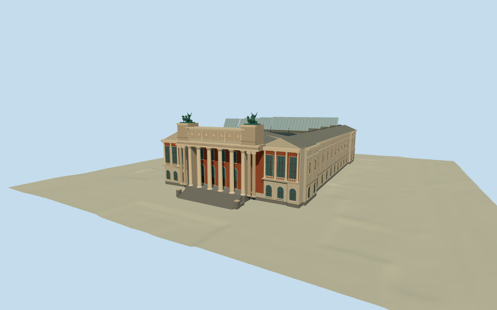

# Royal Museum of Fine Arts Antwerp

The 1890 Antwerp museum with its open Corinthian entrance porch, copper roofs and twin bronze chariots.

Authoring state: **review-in-qa.json**. Current completion evidence is in [qa.json](qa.json) and the [completion ledger](../../../../qualla-structures/batches/qualla-004.PROGRESS.md).

- [Royal Museum of Fine Arts Antwerp](https://qualla.com/royal-museum-of-fine-arts-antwerp/)

Street-side volumes and courtyard roof follow the present footprint, archival façade and current published roof description. Small sculptures, inscriptions, patina and roof glazing detail are representative.

The surface survey predates the 2022 reopening, so modern rooflight height and exact glass panels are estimated.

Build: `node content/worldgen/source/places/u1/u15/royal_museum_of_fine_arts_antwerp/models/generate-royal-museum-of-fine-arts-antwerp.mjs`. Add `--check` to verify exact regeneration. 26000 triangles; 8 materials; no embedded photographs.
