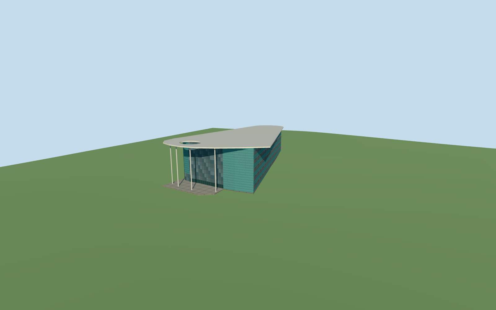

# Solvay Brussels School of Economics and Management

Solvay School R42 with its white cantilevered canopy and circular opening, patinated copper wings, glazed atrium and two entrances.

Authoring state: **review-in-qa.json**. Current completion evidence is in [qa.json](qa.json) and the [local 100 ledger](../../../../qualla-structures/batches/PROGRESS.md).

- [Solvay Brussels School of Economics and Management](https://qualla.com/solvay-brussels-school-of-economics-and-management/)

The model covers the R42 building on the Solbosch campus and its immediate entrances. The other university buildings occupy separate locations.

The underlying mapped perimeter and both entrances are exact horizontal controls. Eave height, west canopy edge and opening, copper panel spacing, and individual façade dimensions are interpreted.

Terrain samples establish the rising grade between entrances as a geographic preview. The broad 12 m site relief also extends off the building footprint. Interior furnishings and signage are simplified.

Build: `node content/worldgen/source/places/u1/u15/solvay_brussels_school_of_economics_and_management/models/generate-solvay-brussels-school-of-economics-and-management.mjs`. Add `--check` to verify exact regeneration. 7163 triangles; 6 materials; no embedded photographs.
