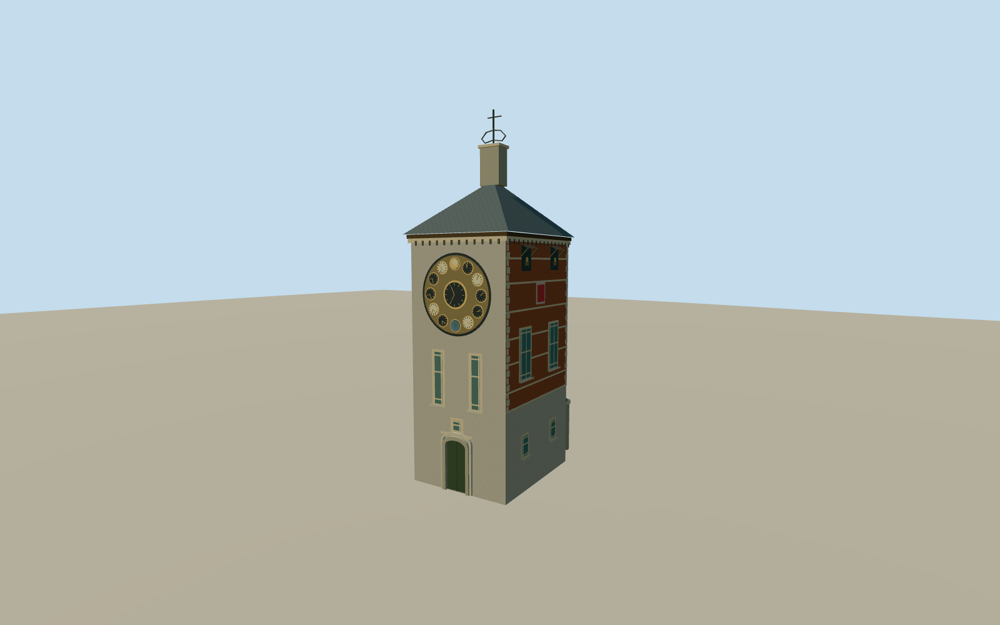

# Zimmer Tower

The sandstone Jubilee Clock façade, brick-and-stone side elevations and slate tent roof of the former Cornelius Tower in Lier.

Authoring state: **review-in-qa.json**. Current completion evidence is in [qa.json](qa.json) and the [completion ledger](../../../../qualla-structures/batches/qualla-003.PROGRESS.md).

- [Zimmer Tower](https://qualla.com/zimmer-tower/)

The exterior represents March 2010. The museum’s three surveyed-by-operator height figures control the main silhouette. Intermediate roof and opening dimensions and the sheltered stairs are estimated.

The clock layout is original simplified geometry based on the visible arrangement of concentric dials. Small dial graphics, figures and inscriptions are simplified.

Original public elevation samples are preserved. Approach paving and individual steps are approximate.

Build: `node content/worldgen/source/places/u1/u15/zimmer_tower/models/generate-zimmer-tower.mjs`. Add `--check` to verify exact regeneration. 4011 triangles; 5 materials; no embedded photographs.
