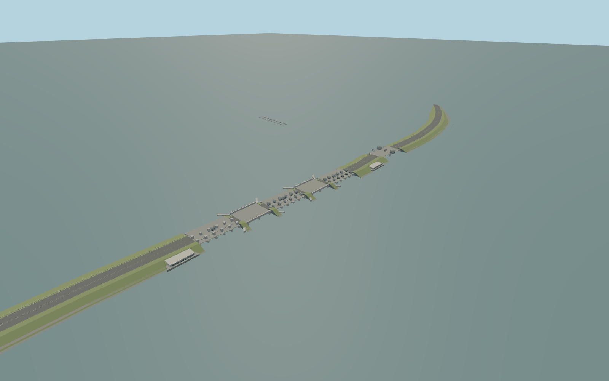

# Afsluitdijk

Full mapped causeway, legacy Stevin and Lorentz sluices, three navigation lock chambers, fish passage, and the visible concrete fronts of the newer Den Oever works. Model elevations and proportions are approximate. The standard PMTiles supplies the road and structure locations. Photographs supply the exterior profiles. Exact tides, gate motion, interior works and future bridge replacements are outside this static model.

Rebuild: `node packages/worldgen/scripts/generate-afsluitdijk.mjs`;append `--check` for exact source bytes. Select import/LOD/placement with `--ids=afsluitdijk`. Detailed source and four browser tiers are separate ignored GLB outputs.

Housing footprints, ramps, service roads, harbors and shorelines remain native. Replacement trims only the identified A7/A31/N31 surfaces within the authored road corridor.

Den Oever includes picture-scale exterior concrete fronts at the four mapped new-works positions. The photographs and PMTiles provide approximate visible massing. Hidden services, tide, gate motion, exact heights and future bridge replacements are outside the model scope.

The nominal 32.5 km source length includes a different extent from the 31.729 km selected corridor. Approaches use the retained standard terrain.

Original geometry:repository license. Map:© OpenStreetMap contributors,ODbL-1.0;Protomaps. Standard terrain:terrain-grid.json. Ordinary pictures stay local and are not redistributed or used as textures. Current acceptance:qa.json.
