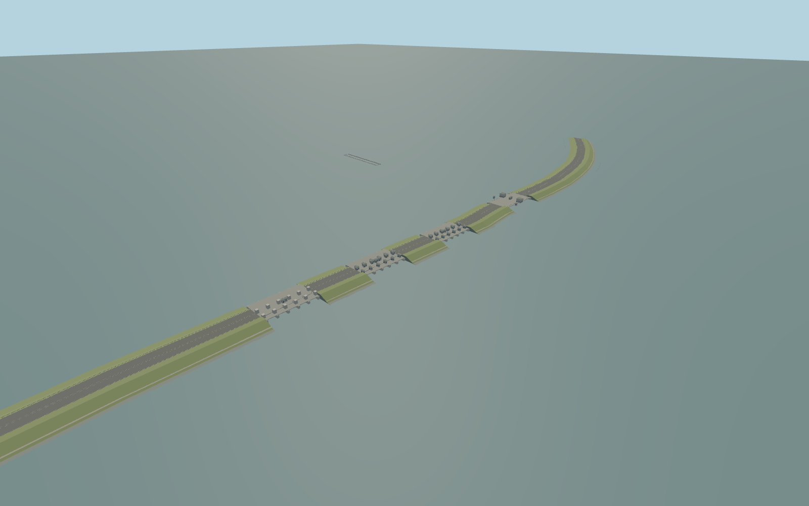

# Afsluitdijk

Whole named Afsluitdijk causeway and both physical sluice/navigation-lock crossings;current map shoreline islands and actual control-house roof footprints. Preserve separate harbor/private buildings,wind turbines,boats,water,public approaches and unrelated structures. Static closed bridge/sluice appearance only;no navigable machinery,interiors,vehicles or copied lettering.

Rebuild: `node packages/worldgen/scripts/generate-afsluitdijk.mjs`;append `--check` for exact source bytes. Select import/LOD/placement with `--ids=afsluitdijk`. Detailed source and four browser tiers are separate ignored GLB outputs.

Whole named Afsluitdijk causeway and both physical sluice/navigation-lock crossings;current map shoreline islands and actual control-house roof footprints. Preserve separate harbor/private buildings,wind turbines,boats,water,public approaches and unrelated structures. Static closed bridge/sluice appearance only;no navigable machinery,interiors,vehicles or copied lettering.

Centerline from current standard A7 PMTiles;bank openings from actual bridge segments,gate houses from native polygons. Heights,embankment cross-section,gate machinery and current construction inventory are explicit picture-based estimates. Source length32500m is retained as a coarse fact;modeled extent follows the selected physical coast-to-coast road endpoints.2013/2024 references differ around Den Oever pumping works;do not invent an unseen completed2026 complex.

Current standard PMTiles plus four ordinary aerial references. Native map road endpoints and bends are retained;32,500m historical source length and the31,728.943m selected mapped centerline extent are different controls,not claimed identical surveys. A7/A31/N31 mainland tie-ins are approximate. Heights,cross-section,gate machinery,lock-chamber dimensions and unseen services are explicit picture-scale estimates. Den Oever2013/2024 construction differs from current map;finished2026 pumping works are unverified and are not invented. Static bridge/gate configuration only. Physical-device/dense-city timing,numerical LOD errors and exact water/terrain contact remain unmeasured.

Five existing shared256px graphs:stone_basalt,concrete_plain,metal_standing_seam,metal_painted,window_grid. Seven near groups including one untextured palette for broad grass landforms;one far palette group. Concrete aggregate is shared for paved road/path surfaces with separate tints. Metric UVs and linear colours;no embedded/private textures. No new common-library changes invalidate other model inputs. Every tier keeps the continuous bent levee,all five sluice banks with five flow bays each,the two navigation crossings,fish passage and three open lock chambers. Near tiers retain the mapped gate-house polygons,window recesses,gate framing and source-authored rails;master keeps dense rail posts. Public harbor islands and independent service properties remain native terrain/map context.

Original geometry:repository license. Map:© OpenStreetMap contributors,ODbL-1.0;Protomaps. Standard terrain:terrain-grid.json. Ordinary pictures stay local and are not redistributed or used as textures. Current acceptance:qa.json.
