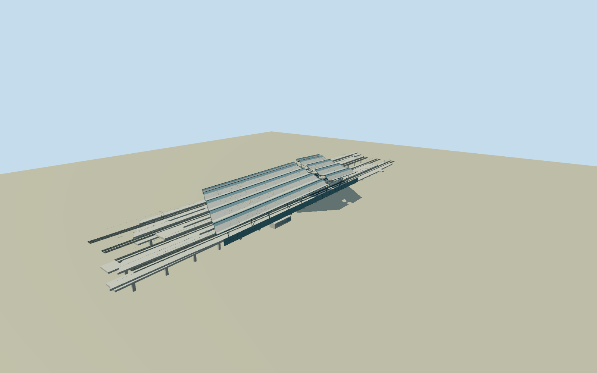

# Amsterdam Bijlmer ArenA station

Complete open elevated station with five timber/glass folded canopy ribbons, diagonal roof cleft and concourse, eight rail lanes on four separate pier-supported viaducts, original long platform vertices/short metro island/stair-light openings, inclined steel columns and roof ribs, framed screens and intrinsic stair/escalator access. Ordinary geographic identity; no neighboring arena/concert hall, trains/people/public plaza or natural ground. Native platform plan, photo/text-controlled characteristic forms and explicitly approximate roof sections/support census.

Authoring state: **review-in-qa.json**. Current completion evidence is in [qa.json](qa.json) and the [completion ledger](../../../../qualla-structures/batches/qualla-002.PROGRESS.md).

- [Amsterdam Bijlmer ArenA station](https://qualla.com/amsterdam-bijlmer-arena-station/)

Original station platform ways, subway stair/lightwell inner ring and eight original rail/subway centerlines identify the complete rail station rather than the nearby arena/AFAS Live. BAG hallway282372392 alone is a diagonal lower-hall polygon, not the complete canopy or station envelope. Native platform vertices and rail intersections are preserved. Five folded200m roof ribbons,70m diagonal boulevard, elevated eight-track configuration and separated open viaduct decks are controlled by primary architect/builder text and the native Qualla photographs. Roof registration/sections and support/auxiliary census are architectural estimates, not an as-built roof survey.

Only three native published Qualla creator own-work PD-self originals control imagery: Mojito platform and concourse photographs and Erik1980 overview station portion. All matched to pinned primary native SHA1 and actually inspected. Neighboring concert hall, trains, people, signs/logos and shops are excluded. Six assumed-source2005pictures and all attribution images excluded; panorama is context only. No outside image, photo texture or generated bitmap.

Original platform and metro stair/lightwell rings and eight track intersections are preserved. Rail paths interpolate original centerlines, with tangent extensions where source ways stop before platform ends. Four viaduct deck widths/sections, pier locations and cantilever supports are explicit estimates. No solid ground-level building or parcel slab fills the open station; longitudinal daylight gaps and diagonal access remain real openings.

Primary architect text controls eight raised tracks,70m boulevard, diagonal split/daylight openings and folded roof identity; builder controls four nominal350m viaducts and18000m²roof/one-third glass. Five nominal200m roof ribbons follow the rail axis with photo-estimated fold/sweep profiles and registration. Native mapped platform extremities include staggered/apron lengths and are not resized to rounded published platform lengths. Exact current roof survey, screens, room/bay census and minor alterations unverified.

Platform10m/trackbed9m/deckbottom7.8m, roof18.5-25.5m and footings-.4m are interpreted sections rather than surveyed elevations. Ground-contact datum chosen before independent raw520mTerrarium field. Source heights can include buildings/vegetation or elevated rail features; no flattening/fitting. Flat inspection stage is not a geographic grade certification.

Intrinsic exterior stairs/escalators, grilles/screens/roof ribs/timber slats, representative overhead contact supports and two low auxiliary enclosures simplify with distance. No full operating rail system, rolling stock, copied signs, interior shops or off-site road/bus structures. Original metro lightwell is preserved; concealed room partitions and foundations omitted.

Build: `node packages/worldgen/scripts/generate-authored-places.mjs --ids=amsterdam_bijlmer_arena_station`. Add `--check` to verify exact regeneration. 36784 triangles; 6 materials; no embedded photographs.
