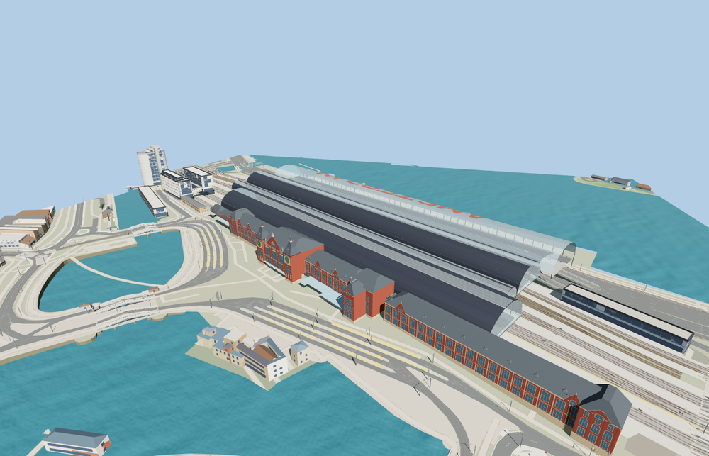

# Amsterdam Centraal

Amsterdam Centraal pairs the red-brick Cuypers frontage, wind dial, clock, gables and mansards with three arched rail sheds. Glazed end screens leave the tracks open below. The modern IJ-side bus canopy spans its raised deck, with the red AMSTERDAM lettering formed in the glass.

The 40,071-triangle source rebuilds byte for byte. Skyline, district, street and close-up use 955, 3,727, 14,131, 33,333 triangles. Skyline and district total 459,068 bytes. Six GLBs validated and 37 current views were inspected.

The model replaces 68 station building records and preserves 294 independent buildings and 961 transportation records. Six track entrances, six platform surfaces, five foundations, five bus deck sections, two tower tops and twelve roof ridge samples pass at each level. The procedural station returns on load failure.

The PMTiles footprints set the position of the historic frontage and four long roofs. The six-meter datum follows standard viewer terrain. Facade ornaments and most elevations are exterior photo estimates. The exterior includes the visible platform canopies, glazed end screens, rail platforms and the raised IJ bus deck. Platform fittings and roof lettering are simplified at viewer scale. Active rail, streets, ferry water and surrounding buildings stay in the underlying map. The above-ground fixture preserves underground transportation records. The corrected renders show Stationsplein and the open entrance bays. The earlier concrete forms came from extending clipped tunnel records into standalone bores.

Rebuild with `node packages/worldgen/scripts/generate-amsterdam-centraal.mjs`. Append `--check` to compare exact bytes. Use `--ids=amsterdam_central_station` for targeted import, LOD, placement and readiness.
