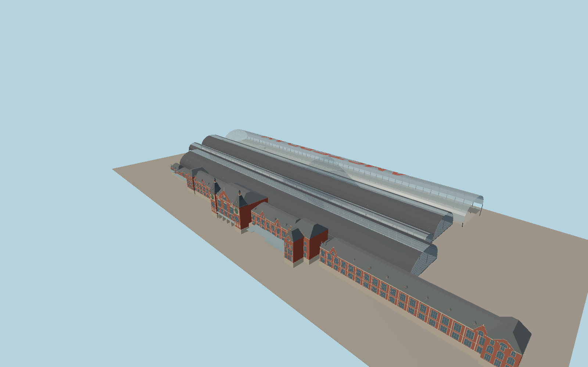

# Amsterdam Centraal

Amsterdam Centraal pairs the red-brick Cuypers frontage, wind dial, clock, gables and mansards with three arched rail sheds. Glazed end screens leave the tracks open below. The modern IJ-side bus canopy spans its raised deck, with the red AMSTERDAM lettering formed in the glass.

Run `node packages/worldgen/scripts/generate-amsterdam-centraal.mjs` to rebuild the source master. Append `--check` to compare the exact bytes. Use `--ids=amsterdam_central_station` for targeted import, LOD generation and placement.

The PMTiles footprints set the position of the historic frontage and four long roofs. The six-meter datum follows standard viewer terrain. Facade ornaments and most elevations are exterior photo estimates.

The exterior includes the visible platform canopies, glazed end screens, rail platforms and the raised IJ bus deck. Platform fittings and roof lettering are simplified at viewer scale. Active rail, streets, ferry water and surrounding buildings stay in the underlying map.

Original geometry follows the repository license. Map data is © OpenStreetMap contributors under ODbL-1.0 via Protomaps. Terrain samples are described in terrain-grid.json. Ordinary pictures stay local and are not redistributed or used as textures. Current acceptance is recorded in qa.json.
