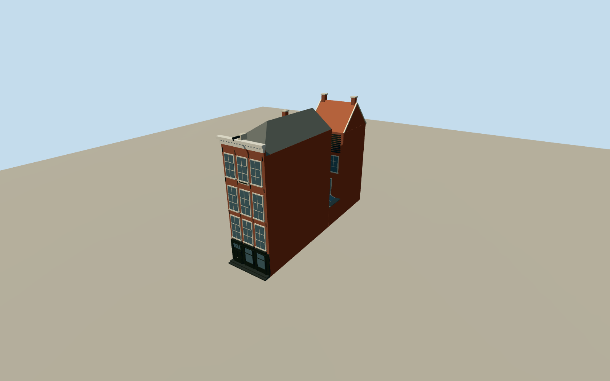

# Anne Frank House

Prinsengracht 263 only: three-bay black storefront and brick upper facade, white cornice and hoist, slate front-house roof, narrow connecting section and transverse red-tiled annex roof.

Authoring state: **review-in-qa.json**. Current completion evidence is in [qa.json](qa.json) and the [local 100 ledger](../../../../qualla-structures/batches/PROGRESS.md).

- [Anne Frank House](https://qualla.com/anne-frank-house/)

Original medium-fi exterior, not a measured reconstruction. Started with the cleared public-domain Qualla streetscape; independently verified CC0 archive exteriors and creator-released courtyard/door photos supply the missing views. Earlier CC photos, museum cutaway and model photograph are excluded from current imagery approval.

The zoom-15 map supplies a generalized 5.88 by 24.1 m envelope. Front/connector/annex partition and window/roof dimensions are estimates; small modern alterations and interiors are omitted.

Adjacent 261, 265 and the modern museum block are excluded. The former draft rear polygon was a neighboring property and has been removed.

Ground contact is reviewed against independently preserved coarse host-terrain samples; this is not elevation survey data. Photographs remain local comparison inputs and are not embedded. The archival rear, courtyard partitions, louver spacing, dormer depth and fine trim are generalized; small modern changes are omitted.

Build: `node packages/worldgen/scripts/generate-authored-places.mjs --ids=anne_frank_house`. Add `--check` to verify exact regeneration. 3232 triangles; 5 materials; no embedded photographs.
