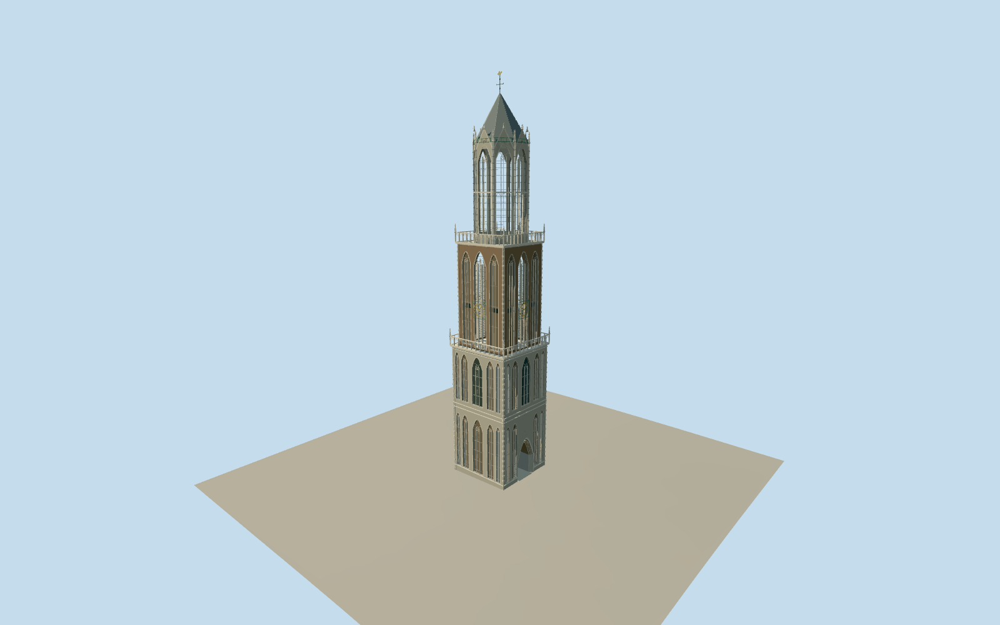

# Dom Tower of Utrecht

Detached Utrecht DomTower: native two square stages and open octagonal lantern. Deep continuous pointed ground passage with layered portal moldings/ribbed soffit and own ground-following paving. Warm brick blind Gothic niches/pale stone quoins, glazed lower lights/physical galleries with pierced pointed/trefoil tracery and crocketed pinnacles. Four green skeletal square clocks/gold Roman rings/hands, real second-stage pointed openings/physical mullions/louvers/iron ties. Giant two-light lantern sections/stone tracery band/deep molded arches/corner buttresses/gables/upper green railing. Short slate/lead octagonal cap/cross and original gilded SaintMartin horseman vane. No cathedral nave/choir/visitorreception/neighbors/scaffold/interior bell machinery.

Authoring state: **review-in-qa.json**. Current completion evidence is in [qa.json](qa.json) and the [local 100 ledger](../../../../qualla-structures/batches/PROGRESS.md).

- [Dom Tower of Utrecht](https://qualla.com/dom-tower-of-utrecht/)

Appearance combines2006–2012day geometry detail and2024post-restoration night exterior, with1958RCEdetails used only where corroborated later. No claim to current2026block-by-block repair finish.

Native lower~19.5×19.5m/second~16.8×16.6m/octagonal lantern outline retained; official38.6/68.08/94.08/106.75/112.32mstage/top controls. Widths/portal/window/crown/moldings/threshold engineering remain proportional estimates.

23×23m/5.5mfoundation excavation is historical comparison only, not aboveground footprint. No cathedral choir/nave/bridgechapel, separate1920svisitor reception, surrounding shops/square/streetlights/scaffolds/people or interiors/bell mechanism.

Original Gothic tracery/crockets/gargoyle/vane silhouette approximate detail; not literal fine carvings, text, coatsofarms or photo textures.

Independent terrain acquired before geometry without flattening or fitting. Passage floor uses own sampled ground approach; host dataset compatibility remains uncertain.

Build: `node packages/worldgen/scripts/generate-authored-places.mjs --ids=dom_tower_of_utrecht`. Add `--check` to verify exact regeneration. 59614 triangles; 7 materials; no embedded photographs.
