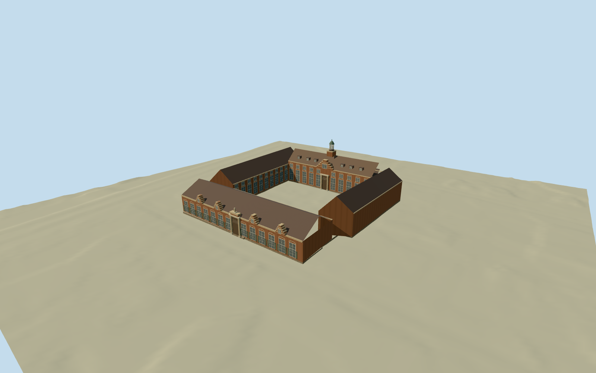

# Frans Hals Museum

The Frans Hals Museum’s historic Haarlem courtyard and almshouse wings, leaded façades and lantern.

Authoring state: **review-in-qa.json**. Current completion evidence is in [qa.json](qa.json) and the [completion ledger](../../../../qualla-structures/batches/qualla-004.PROGRESS.md).

- [Frans Hals Museum](https://qualla.com/frans-hals-museum/)

Models the principal historic museum at its Hof address. The separate Hal and individually mapped adjoining buildings are outside the site model.

The courtyard, grouped shutters, masonry, entry work and varying roofs follow the archive and survey. Fine ornament, roof tile joints and nonprincipal outer walls are representative.

Build: `node content/worldgen/source/places/u1/u17/frans_hals_museum/models/generate-frans-hals-museum.mjs`. Add `--check` to verify exact regeneration. 4310 triangles; 6 materials; no embedded photographs.
