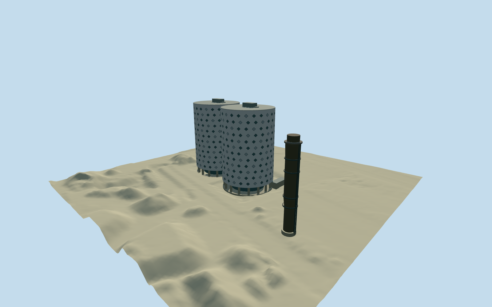

# Halfweg Sugar Factory

The former Halfweg Sugar Factory’s two circular aluminum-clad silos and surviving lime kiln.

Authoring state: **review-in-qa.json**. Current completion evidence is in [qa.json](qa.json) and the [completion ledger](../../../../qualla-structures/batches/qualla-004.PROGRESS.md).

- [Halfweg Sugar Factory](https://qualla.com/halfweg-sugar-factory/)

This entry represents the retained skyline structures. The neighboring event hall, mall and smaller factory buildings are outside the authored scope.

Roof levels and centers use the national surface survey. The exact window mosaic, exposed base structures and kiln platforms are estimated from the public-domain photo and architect’s description.

Build: `node content/worldgen/source/places/u1/u17/halfweg_sugar_factory/models/generate-halfweg-sugar-factory.mjs`. Add `--check` to verify exact regeneration. 9180 triangles; 5 materials; no embedded photographs.
