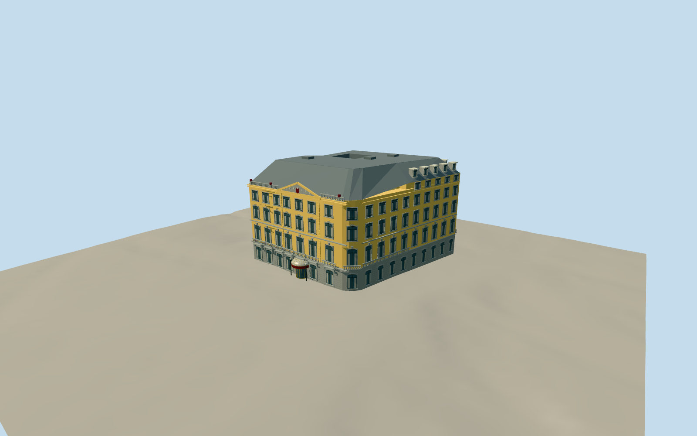

# Hotel des Indes (The Hague)

Ochre historic hotel with gray rusticated base, seven-axis main front, rounded corner, central pediment, glazed semicircular entrance and taller dormered rear mansard.

Authoring state: **review-in-qa.json**. Current completion evidence is in [qa.json](qa.json) and the [local 100 ledger](../../../../qualla-structures/batches/PROGRESS.md).

- [Hotel des Indes (The Hague)](https://qualla.com/hotel-des-indes-the-hague/)

Original medium-fi exterior based on individually inspected local front, entrance and rear-corner photographs; interiors excluded.

Mapped footprint and AHN4 surface heights control overall geometry; window/storey dimensions, upper court, roof joins and hidden elevations are estimates.

Simplified original relief and ornament; no copied photo textures, exact crest or lettering. Temporary flags, holiday decorations and crowds excluded.

AHN4 roof evidence dates to 2020–2022. Terrain ground beneath the building requires explicit gap interpolation; another host DEM can differ.

Build: `node packages/worldgen/scripts/generate-authored-places.mjs --ids=hotel_des_indes`. Add `--check` to verify exact regeneration. 28305 triangles; 7 materials; no embedded photographs.
