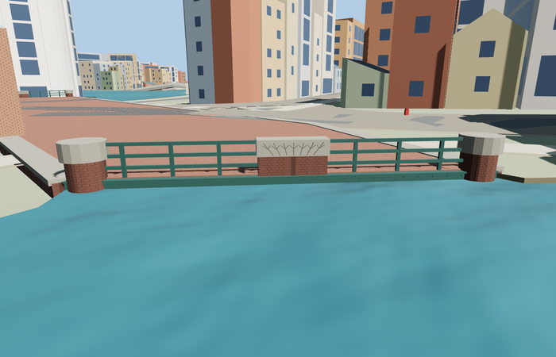

# Muntplein / Muntsluis — draft

Reviewed 2026-10-27. **Not ready; geographic placement is disabled by default.**

Inspected 51 current frames: 11 portable, 23 medium-fi and 17 native. Irregular plaza deck, brick abutments/round feet, open canal geometry, green flange/rivet girders, three-bar open rails, pale caps, branching stone-panel relief and generalized embedded tram tracks are present. Native west portal is largely hidden by the coarse water surface; some context cameras are obstructed by retained buildings or lie below the cut. Placement and final fidelity approval remain pending. No new ready candidate is claimed.

The original candidate is Muntplein/Q683180. Muntsluis/Q2308267 is its physical bridge component. Existing Munttoren/Q1429748 is separately loaded without changing its reviewed source or counting it again. The pedestrian map polygon is retained as an input; an explicit 5.6m northwest-edge expansion encompasses the mapped carriageway/tram corridor. This inferred boundary is not an exact-QID bridge footprint.

Master: 8808 triangles / 1059884 bytes. Runtime triangles: 432 / 1008 / 1512 / 5640; initial skyline + district: 132636 bytes. Four existing shared material graphs, no embedded images and separate runtime GPU streams. Six clean GLBs,166 recorded geometry checks, scene validation and30 ticks pass. Physical-device timing is unmeasured.

## Remaining work

- Resolve native canal-water/ground fit without raising the whole plaza and burying Munttoren's base.
- Reconcile actual junction widths against the inferred transport envelope.
- Replace obstructed/below-cut native cameras and inspect the corrected fit.

These are localized remaining fit tasks, not a request to repeat photo/identity research or reconstruct the source from scratch. Existing source, hashes, material checks and inspected geometry are retained.
