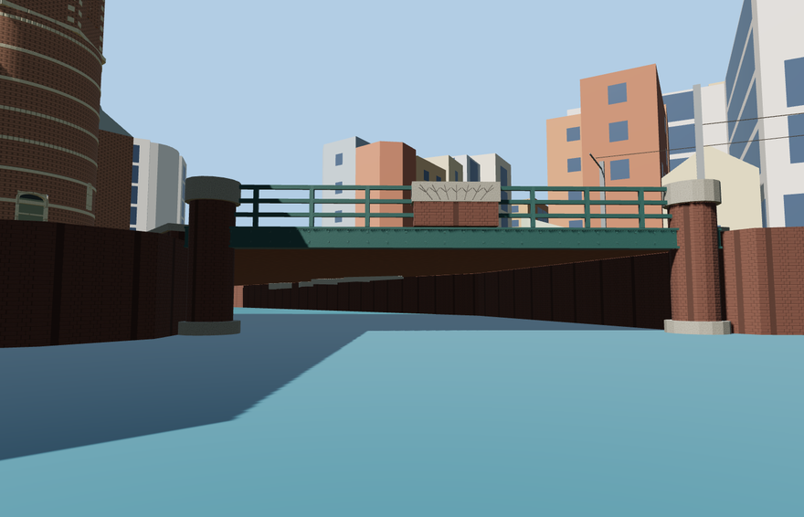
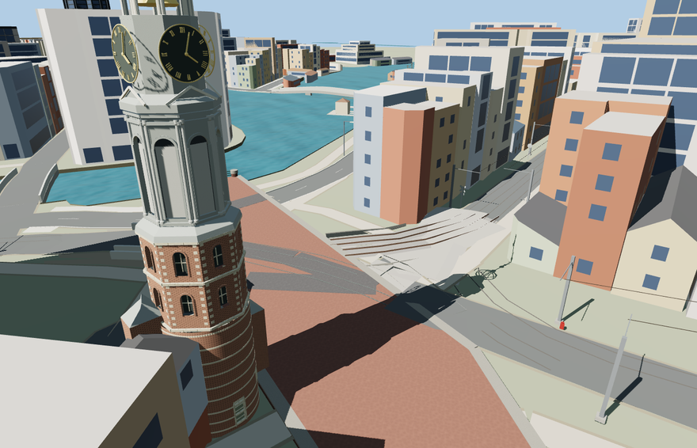

# Muntplein / Muntsluis review

Reviewed 2026-11-14. Muntplein is active in the Amsterdam placement catalog.

The native water surface obscured the west opening. The model now renders a local canal surface and brick bank strips within the mapped channel. The water meets the adjoining Singel surface along a short transition, and the bridge and neighboring Munttoren stay at their existing datum. This corrects the display against coarse terrain and water samples. The approach shoulders remain photo- and PMTiles-derived, and water elevations depend on the host terrain data.

At all four detail levels the passage has at least 2.14 m of clearance in the fixture (rounded), and matched road samples meet the bridge within 2.8 cm. Unloading the model or failing to load it restores the native ground and water. The fixture retains 440 independent road features and the nearby Doelensluis crossing. Munttoren renders as its own landmark.

Six GLBs passed validation, including four runtime detail levels with four shared material graphs and no embedded images. The skyline and district GLBs total about 142 kB. The review covers 166 geometry probes and 22 viewer captures. [Recorded checks and limits](shared-capture-report.json)

