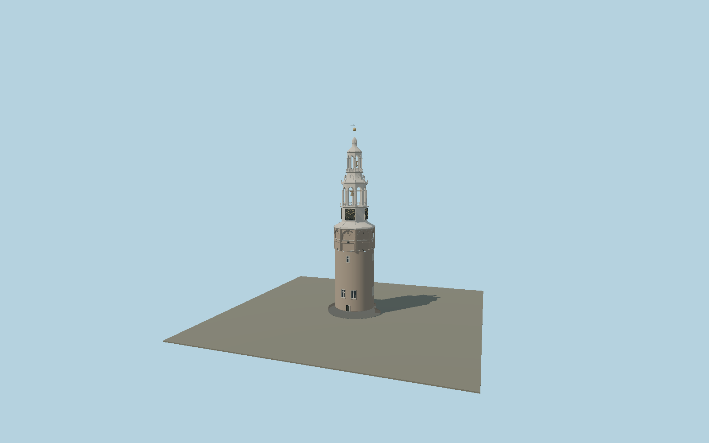

# Montelbaanstoren

Amsterdam’s round brick defensive tower with broad 1610 foot, octagonal upper masonry, four black-and-gold Roman clock faces, two genuinely open lead-clad timber stages, bells, balustrades, curved Renaissance scrolls and slender crown/finial.

## Identity and geometry

Catalog N0622, [Q1946061](https://www.wikidata.org/wiki/Q1946061). The municipal measured section’s 0–10 m bar gives approximately 42.05 m above its ground line. AHN4 surface peak 43.5 m NAP and nearby pavement around 2.02 m NAP independently support a roughly 42 m exterior, but raster sampling can miss the narrow finial. The catalog’s 48 m historical figure is retained as conflicting evidence, not silently used to stretch the drawing.

Actual Google Sep2024 panorama at2Oudeschans viewed from52.3720711,4.9055057 shows pavement-level entrance and stone-cross window on the land-facing west-northwest side. North-up satellite places road west/northwest and canal east/southeast; inspected2016southwest and2017northeast canal photographs confirm the paired canal windows. The mapped west straight edge defines heading1.407879250402rad: native-Z land entrance, native+Z canal facade. Approximately20degree facade reconstruction uncertainty covers round-facade angular placements/clock alignment; not a surveyed clock-plane azimuth.. Native-Z is the west-northwest land entrance; native+Z is the canal-facing paired-window side.; +Y is up. The geographic proposal identifies its anchor and orientation evidence separately from remaining terrain and azimuth uncertainty.

Source facts and measured references are recorded in spec.json. References: [1](https://monumentenregister.cultureelerfgoed.nl/monumenten/4025), [2](https://www.amsterdam.nl/stadsarchief/stukken/grachten-torens/montelbaanstoren/), [3](https://pure.uva.nl/ws/files/2809631/178913_Historisch_hout_in_Amsterdamse_monumenten.pdf), [4](https://www.amsterdam-monumentenstad.nl/database/grachtenboek_objecten.php?id=5391), [5](https://service.pdok.nl/rws/actueel-hoogtebestand-nederland/wcs/v1_0?SERVICE=WCS&REQUEST=GetCapabilities), [6](https://www.openstreetmap.org/way/57864086). Reference pages and images are not redistributed.

## Original source and shared materials

Geometry is authored in `packages/worldgen/scripts/montelbaanstoren-model.mjs`. Shared material graphs with metric repeat UV0 and original vertex tints; GLB PBR fallback remains self-contained. No per-model texture duplication. No third-party mesh or photograph is embedded.

107,734 triangles; 210,264 vertices; 5 material groups; 8,865,588 source bytes. Source hash: `sha256:6f9bc434f574d8c01556829802aa76f0d0e828234a7c9fd9d8473e4be2934f43`. Geometry validation checks finite Float32 coordinates, indices, triangle area and winding before export.

Regenerate with `node packages/worldgen/scripts/generate-heritage-towers.mjs N0622`; add `--check` for reproducibility. The generator refuses to overwrite a master whose hash differs from source.json. Import uses `--no-optimize` to preserve facade recesses.

## Remaining detail and review

- Reviewed static medium-fi exterior derived from the municipal measured section and actual2015/2016/2017 facade photographs. The original123692-triangle draft is preserved unchanged. The42.05m section-derived working height is retained; the historical48m description and AHN4 approximate surface/ground context remain conflicting/non-survey evidence. Repair maps the asymmetric foot, paired canal windows and stone crosses, filled upper brick niches and complete open lanterns. Window placements, repair brickwork, lead seams, scrolls and crown details are approximate original reconstructions. Static10:10 clocks; hidden timber frame, mechanisms, buried foundations, quay, moored boats and vegetation are excluded. Terrain-contact base needs local host pavement fitting; footprint replacement disabled.

Named near/far cameras are included for lit visual review. A valid export is not maximum-fidelity certification.
