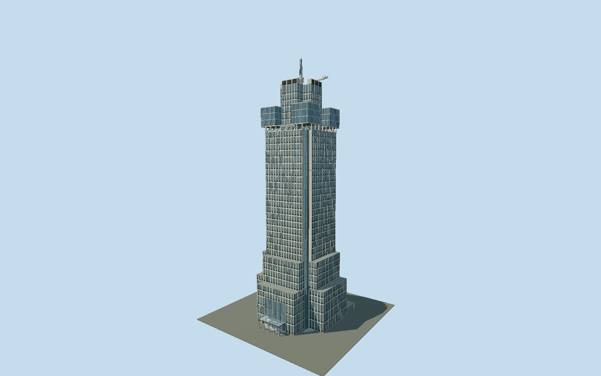

# Rembrandt Tower

Amsterdam’s granite-clad Rembrandt Tower: stepped cross-shaped podium, fourteen-bay facades with deeply recessed glazed corners, seven-bay open crown galleries, four glazed corner towers, a cross-shaped mechanical cap, ringed beacon and parked maintenance crane. The southern entrance has three revolving doors and a projecting canopy.

## Evidence and reconstruction

Published dimensions and reconstructed details are separated in spec.json. Primary references:

- [Reference](https://www.zzdp.nl/nl/project/de-omval)
- [Reference](https://arcam.nl/architectuur-gids/rembrandttoren/)
- [Reference](https://www.rembrandttower.nl/nl/)
- [Reference](https://repository.tudelft.nl/file/File_22b7fccf-7ca6-4d29-aa2d-6d47cf923d6c)
- [Reference](https://api.3dbag.nl/collections/pand/items/NL.IMBAG.Pand.0363100012113758)
- [Reference](https://docs.3dbag.nl/en/copyright/)
- [Reference](https://www.openstreetmap.org/way/44451577)

No third-party geometry, photograph or bitmap texture is embedded. Shared surface graphs come from the central library; vertex tints carry model colors. Glazing uses PBR materials; transparent surfaces are declared per model.

## Model and axes

642,002 triangles; 1,281,444 vertices; 8 material groups; 53,840,488 bytes. Native bounds: -23.660, 0.000, -23.920 to 24.380, 150.000, 29.600. Source hash: `sha256:dc971bb1d2723fa9a09a2dd3e017bd1d187184069bc9f903971af407a957500f`.

{"up":"+Y","longitudinal":"+X east-northeast along the BAG rear wall","front":"+Z south-southeast toward the entrance square","origin":"Center of the BAG ground-envelope rectangle; Y0 uses terrain contact. The upper shaft is offset0.36m east and0.10m south in this frame. Native+X east-northeast follows the retained BAG rear edge; native+Z south-southeast faces Amstelplein entrance. Arcam explicitly describes the southern canopy/entrance. Inspected north-up satellite shows canopy at that side; November2020 panorama from52.3447836,4.9175248 looking337.11degrees shows the projecting glazed canopy and five columns. Retained RD-to-WGS84 operation accuracy1m; heading0.3589785079857852rad is a mapped/photo reconstruction with approximately3degree uncertainty, not surveyed azimuth."}

The geographic proposal uses exact-QID OpenStreetMap evidence. Map-derived orientation and estimated architectural details require real-site visual review; preview eligibility is distinct from geographic/fidelity approval. Map attribution: © OpenStreetMap contributors, ODbL-1.0.

## Reproduce

Run `node packages/worldgen/scripts/generate-signature-towers.mjs --ids=N0623` (or add `--check`). The generator preserves manually edited masters by checking their baseline hashes. Import through the standard authored-model workflow with optimization disabled; then capture all QA cameras, including shared-surface views.

## Pending work

- Static medium-fi exterior preserves the original641134-triangle detailed draft and supplies a separately reviewed canopy/column source correction plus four complete browser levels. Published135m roof and150m tip are retained. 3DBAG2023 horizontal roof datums are approximate (1.10mRMSE and104/203 flags), not fabrication drawings. Thirty-five/36floor conventions and3.4mtypical versus3.49minterpolated shaft pitch remain unresolved. Granite joints, window returns, canopy dimensions, beacon and parked crane are reconstructed. Four corner crown towers use three proportional intervals rather than treating Arcam four-storey description as a measured floor plan. Hidden interiors, basement, neighboring towers, landscape, lighting animations and street furniture are excluded. Local host pavement fitting is required; terrain-contact preview is not a sidewalk survey and footprint replacement is disabled. Entrance landing0.45m and three steps are photographic proportions; actual pavement fitting remains required.

This bundle follows the medium-fi standard. Medium-fi appearance and geographic fit are reviewed separately. Hash-bound visual acceptance is recorded separately after capture inspection.

## Additional geographic data

© 3DBAG by tudelft3d and 3DGI, [CC BY4.0](https://docs.3dbag.nl/en/copyright/). The source bundle retains the2023 CityJSON response, converted footprint, roof measurements and coordinate operation. Molen regularizes architectural modules and roof levels and authors new facade geometry; it does not claim a surveyed reconstruction. Identity evidence: © OpenStreetMap contributors, ODbL1.0.
