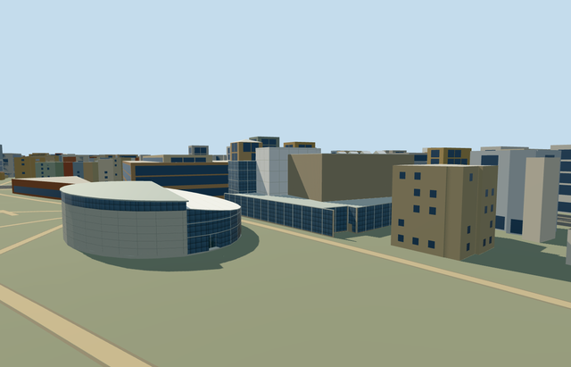

# N0754 — Van Gogh Museum, Rietveld building and Kurokawa wing

Reviewed 2026-10-22. **Completed medium-fi exterior with approximate native placement; Complete mapped main block, elliptical wing and curved entrance.**

## Built and inspected

Complete mapped Van Gogh Museum exterior: stepped gray-beige long-format brick Rietveld block/low glazed perimeter, white-framed dark16m and frosted20m stacks, light roof strips and four modest schematic rooflights; Kurokawa rounded stone exhibition half with upper glazing slot, sloping closed metal roof/eave; northern curved glazed entrance with sloping framed opaque roof and a genuine1.2m deep doorway recess/soffit. Small mapped3m canopy remains a roof only. Three ordinary pictures plus standard map guided one author/inspect/fix pass. Normalized a ground-only snapped degeneracy, changed brick-like cladding to raw limestone with broad geometric joints, improved frost/frame contrast and street framing. No art posters, lettering, furnished galleries or unseen basement passages.

## Shared materials and browser LODs

Four existing256px shared graphs: brick_longformat neutral warm masonry; stone_limestone_raw panel faces/footings; metal_painted light roof membrane/eaves, opaque frosted glazing/roof, white framework and restrained joints; storefront opaque dark glazing. Raw limestone and broad modeled joints substitute for dressed panel cladding; painted metal substitutes for membrane/frosted glass. No new graph/private atlas/embedded image. Actual draw/triangle costs below. Linear tints, common surface bindings, separate POSITION/NORMAL streams and equal CPU/GPU byte accounting. Each native textured run reads each graph once; all LOD unloads release model geometry.

| Level | Triangles | Bytes | Draws |
| --- | ---: | ---: | ---: |
| skyline | 828 | 63464 | 1 |
| district | 2044 | 168028 | 6 |
| street | 2554 | 214040 | 6 |
| closeup | 2554 | 214040 | 6 |

Four authored LODs 828 / 2044 / 2554 / 2554 triangles, within 1k / 4k / 16k / 64k caps. Initial skyline+district geometry 231492 bytes; shared material bakes cached separately. Six GLBs have zero Khronos errors/warnings; 141 actual geometry/contact probes and 20 actual PMTiles13/14/15 cases pass, including12 detailed owned records. Inspected 48 current portable/shared/medium-fi/native frames, all LODs, failed loading, Economy/High and noon/late light. Physical device/dense-city timings remain pending.

## Geographic placement

Approximate native exterior fit reviewed. Q224124 and named museum relation6577680/native52776564710928 own both principal volumes. Also own duplicate elliptical way441830027, eight Rietveld height/roof parts and two elliptical parts:12 map records. Anchor[4.881111111,52.358333333], heading0; internalX east-northeast along mapped street wall/internalZ south-southeast toward ellipse, baked into native east/south coordinates. Existing201x201/6m terrain; uncovered east entrance approach fixes datum4.490051119627603m, working floor0.2m above provider. Boundary grades-0.690..+0.469m leave a modest foundation/slight uphill burial. Ground-only1mm snapped rings normalized to simple polygons; ownership remains1micrometer. Only occupied floors cut ground: original gap and ground beneath3m roof canopy retained. Preserve3,799 resident/4,602 wider independent buildings, including every Stedelijk/Moco record, original roads and295,370.976680m² water. Failure keeps3,811 originals; every LOD unload restores ground/water and zero live geometry. Controlled native fixture selects this complete asset; exact sunken entrance, paving, basement passage and accessibility remain approximate.

## Fidelity and limits

Medium-fi exterior of the complete mapped main block, elliptical wing and curved entrance. Main3/5/6/12/16/18/20m and wing8/10m tags unqualified; panels/glass role assignment and frame inventory are photo-led. Working Kurokawa wall7.8m, sloping roof around10m, glazed entrance5.6..8m and four small upper rooflights are reconstructed. Frosted roof/glass are opaque shared-material substitutes; stone panel joints are broad approximations. Skyline reduces curved halves and flattens the small entry; district/street/closeup preserve its real recess/soffit. Hidden elevations, rooflight count, canopy structure and exact underground access simplified. No furnished galleries, paintings, art posters, logos/signage, operating doors or surveyed engineering. Source map has two separate ground polygons; no invented above-ground connector crosses their gap. Physical device/dense-city timings remain pending.

## Targeted checks

Selected generation/import/placement, strict medium-fi, scene/sim30 and recipe lint pass. Sim30 sha256:c14ccf7249163e71ca39835760666f57619e3c8ed25f5afec8480060a09b5735. Pins: [qa.json](qa.json); [source controls](map-frame.json).

## Viewed references

- https://commons.wikimedia.org/wiki/File:Exterior_of_Rietveldgebouw_Van_Gogh_Museum_IMG_5158.jpg — Alexander Migl (Alexander-93); 2021-08-09; CC-BY-SA-4.0. Viewed only; no copied pixels.

- https://commons.wikimedia.org/wiki/File:Van_Gogh_Museum,_Kurokawa_wing.jpg — Sebastian Koppehel; 2016-10-14; CC-BY-4.0. Viewed only; no copied pixels.

- https://commons.wikimedia.org/wiki/File:Van_Gogh_Museum_Amsterdam_2017.jpg — Steven Lek (Tukka); 2017-12-19; CC-BY-SA-4.0. Viewed only; no copied pixels.

- https://www.openstreetmap.org/relation/6577680 — two-polygon museum footprint and height parts, ©OpenStreetMap contributors ODbL-1.0. Standard PMTiles/Mapzen, no bespoke terrain research.

## Completion checklist

- [x] Source rebuild, import, four authored LODs and existing shared materials.
- [x] Current actual source/shared/native views, geometry and lifecycle checks.
- [x] Independent identity, map orientation and approximate hillside placement.
- [x] Both principal volumes and curved entrance; independent neighbors retained.
