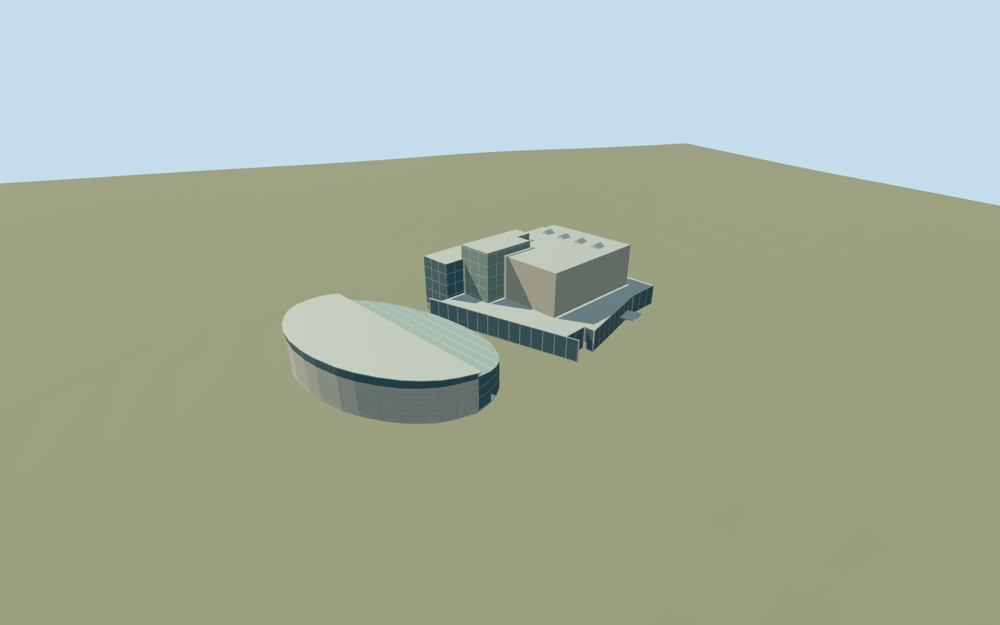

# Van Gogh Museum, Rietveld building and Kurokawa wing

Full mapped Van Gogh Museum exterior: stepped Rietveld gray-beige brick volumes and low glazed perimeter, two tall white-framed dark/frosted glazed stacks, light roof strips/clerestories, Kurokawa stone semicircular exhibition volume with sloping overhanging metal roof/clerestory, and northern curved glazed entrance with a real recessed doorway. One parent multipolygon owns both principal volumes; retain the intervening original ground and every independent Stedelijk/Moco building. Exterior only: no art posters, signs, furnished galleries, unseen basement rooms or connecting passages.

## Evidence and reconstruction

Published dimensions and reconstructed details are separated in spec.json. Primary references:

- [Reference](https://commons.wikimedia.org/wiki/File:Exterior_of_Rietveldgebouw_Van_Gogh_Museum_IMG_5158.jpg)
- [Reference](https://commons.wikimedia.org/wiki/File:Van_Gogh_Museum,_Kurokawa_wing.jpg)
- [Reference](https://commons.wikimedia.org/wiki/File:Van_Gogh_Museum_Amsterdam_2017.jpg)

Full mapped Van Gogh Museum exterior: stepped Rietveld gray-beige brick volumes and low glazed perimeter, two tall white-framed dark/frosted glazed stacks, light roof strips/clerestories, Kurokawa stone semicircular exhibition volume with sloping overhanging metal roof/clerestory, and northern curved glazed entrance with a real recessed doorway. One parent multipolygon owns both principal volumes; retain the intervening original ground and every independent Stedelijk/Moco building. Exterior only: no art posters, signs, furnished galleries, unseen basement rooms or connecting passages.

## Model and axes

2,554 triangles; 7,226 vertices; 6 material groups; 294,696 bytes. Native bounds: -37.463, -0.840, -36.045 to 42.313, 20.200, 65.358. Source hash: `sha256:a501c74f81e51b4c3a0fb783b4a452b0dddf7cc8e7b87085ca5c62617b67f432`.

{"x":"east","y":"up","z":"south"}

The geographic proposal uses exact-QID OpenStreetMap evidence. Map-derived orientation and estimated architectural details require real-site visual review; preview eligibility is distinct from geographic/fidelity approval. Map attribution: © OpenStreetMap contributors, ODbL-1.0.

## Reproduce

Run `node packages/worldgen/scripts/generate-additional-landmarks.mjs --ids=N0754` (or add `--check`). The generator preserves manually edited masters by checking their baseline hashes. Import through the standard authored-model workflow with optimization disabled; then capture all QA cameras, including shared-surface views.

## Pending work

- Full mapped Van Gogh Museum exterior: stepped Rietveld gray-beige brick volumes and low glazed perimeter, two tall white-framed dark/frosted glazed stacks, light roof strips/clerestories, Kurokawa stone semicircular exhibition volume with sloping overhanging metal roof/clerestory, and northern curved glazed entrance with a real recessed doorway. One parent multipolygon owns both principal volumes; retain the intervening original ground and every independent Stedelijk/Moco building. Exterior only: no art posters, signs, furnished galleries, unseen basement rooms or connecting passages.
- Q224124 and named museum POI on relation6577680/native52776564710928 identify the complete two-polygon museum. Include the duplicate elliptical way441830027 and eight Rietveld height parts/one roof canopy plus two ellipse height parts:12 owned map records total. Own candidate anchor[4.881111111,52.358333333]. InternalX follows the mapped east-northeast street wall; internalZ south-southeast toward the ellipse. Heading0, orientation baked into native east/south coordinates. Main height parts3/5/6/12/16/18/20m and wing8/10m are map tags, unqualified. Exact mapped part outlines, separated volumes and signed axes guide fit; the museum is one runtime asset to own the complete parent footprint.
- Mapped height parts are unqualified: main5/6/12/16/18/20m and small3m canopy, wing8/10m. Reconstruct brick main blocks, glazed16/20m stacks, thin roof parapets/limited schematic rooflights, Kurokawa wall7.8m/clerestory/sloping roof about10m, northern glazed entrance from5.6 to8m. Three ordinary photos guide colors, white frame grids and curved facade/roof. Hidden elevations, exact panel/frame counts, roof profile/fixtures and below-ground access are simplified. Existing brick_longformat/limestone/painted-metal/storefront graphs; frosted glass/roof membrane use painted-metal substitutes. No private textures or copied imagery.
- Standard Protomaps20261020 plus MapzenTerrarium original201x201/6m grid. Uncovered entrance approach fixes datum4.490051119627603m; working floor0.2m above provider. Closed occupied-footprint foundations follow minimum original boundary grade. The isolated roof canopy owns/replaces its mapped roof part but keeps the original ground below it. Original gap between principal volumes, roads/water and all independent neighbors retained. Approximate native exterior fit reviewed on original terrain; boundary grades-0.690..+0.469m leave a modest foundation/slight uphill burial. Exact sunken entrance, historic paving, basement passage and accessibility remain unverified. No bespoke terrain research or broad flattening.

This bundle follows the medium-fi standard. Medium-fi appearance and geographic fit are reviewed separately. Hash-bound visual acceptance is recorded separately after capture inspection.
