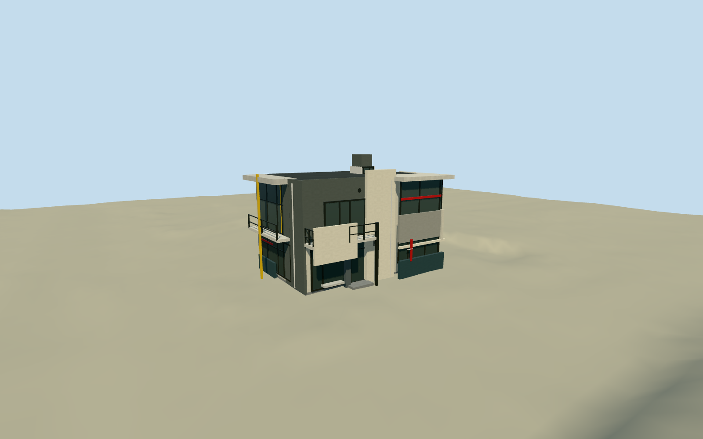

# Rietveld Schröder House

The restored end-of-terrace house with the De Stijl wall planes, projecting balconies, wraparound glazing and slender primary-colour steel profiles.

Authoring state: **review-in-qa.json**. Current completion evidence is in [qa.json](qa.json) and the [completion ledger](../../../../qualla-structures/batches/qualla-004.PROGRESS.md).

- [Rietveld Schröder House](https://qualla.com/rietveld-schroder-house/)

The model covers the restored exterior. It leaves out interior partitions, furnishings, the adjacent terrace house and the visitor centre.

Main painted planes and primary-colour accents follow the cleared colour photograph. The less photographed garden return and exact glazing reflectance are approximate.

Build: `node content/worldgen/source/places/u1/u17/rietveld_schroder_house/models/generate-rietveld-schroder-house.mjs`. Add `--check` to verify exact regeneration. 1878 triangles; 5 materials; no embedded photographs.
