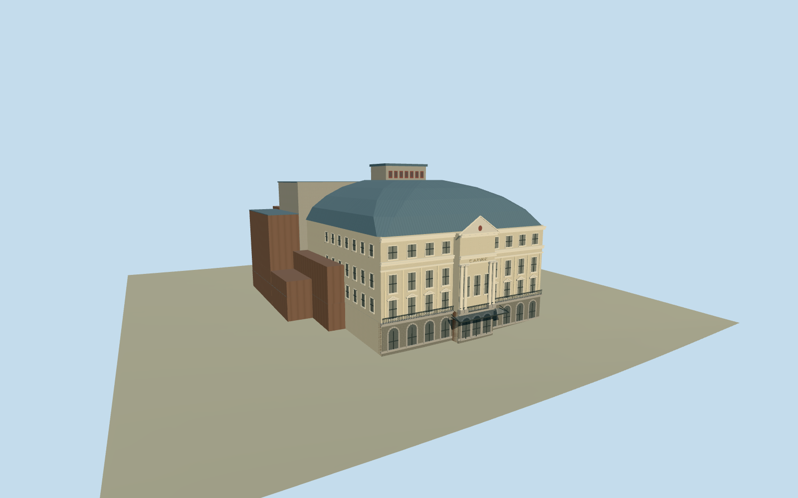

# Royal Theatre Carré

Amsterdam’s Royal Theatre Carré with its plastered Neo-Renaissance Amstel facade and bowed zinc roof.

Authoring state: **review-in-qa.json**. Current completion evidence is in [qa.json](qa.json) and the [completion ledger](../../../../qualla-structures/batches/qualla-004.PROGRESS.md).

- [Royal Theater Carré](https://qualla.com/royal-theater-carre/)

The decorative capitals and balustrades are simplified, and the rear glazing and services use architectural estimates.

Terrain and the model cover the building and its immediate site. The canal locks, nearby houses and temporary signs are outside the scope.

Build: `node content/worldgen/source/places/u1/u17/royal_theater_carre/models/generate-royal-theater-carre.mjs`. Add `--check` to verify exact regeneration. 8499 triangles; 8 materials; no embedded photographs.
