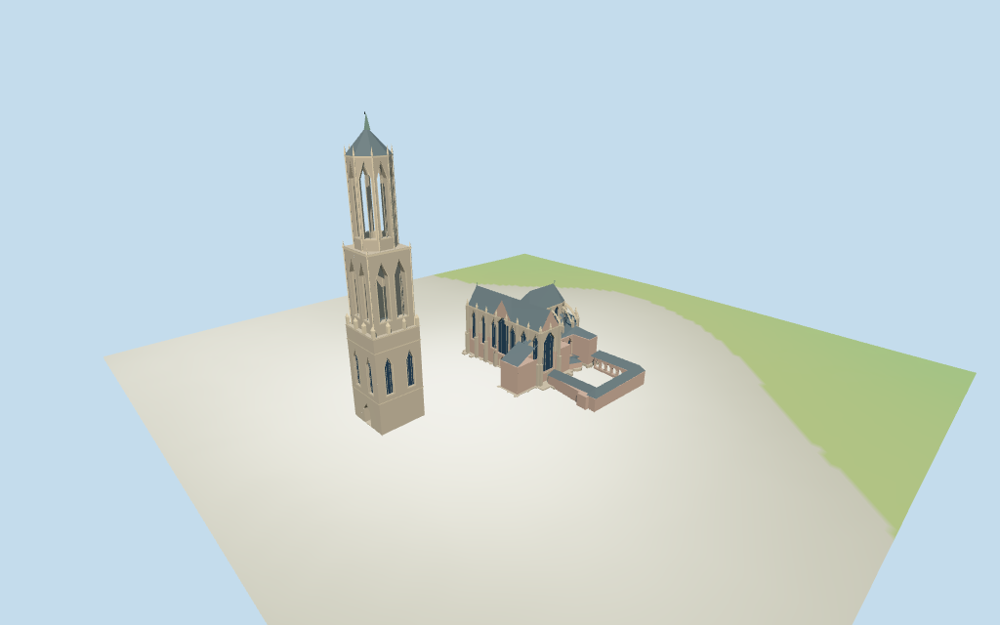

# st_martins_cathedral_utrecht — St. Martin’s Cathedral, Utrecht review

Reviewed 2026-10-15 against current source/runtime bytes. Accepted for the medium-fi surviving exterior and approximate geographic/terrain scope.

## Built result

Inspected all 11 current portable/source-terrain frames. Surviving Utrecht Domkerk has a broad north/south transept, central western gable/entry, narrow polygonal eastern choir, gray slate cross roof, lower ambulatory/chapels, pointed recessed glazing and restrained pale tracery. Warm gray-pink brick and stone, flying buttress curves, stepped piers and pinnacles carry the medium-fi identity. Separate Dom Tower remains west across an open square: broad square base with a real through-passage, narrower square belfry, open octagonal upper lantern, slate cap and metal tip. South U-shaped low cloister has open garden arcades and a clear central courtyard. Fixed a thin plan sliver that distorted the choir roof, separated low vestry/porch walls and roofs, regularized tiny outer buttress notches to the mapped high/aisle union, restored the central west gable and omitted an arcade blocked by the annex. Detailed foundation retains the raw mapped perimeter. Exact sculpture, clock/inscription detail, bells and internal stairs are omitted.

Medium-fi surviving exterior based on four useful pictures and standard viewer PMTiles/DEM only. Map controls preserve plan, height and min_height evidence; church/tower subdivisions, roof slopes, flying buttresses, pinnacles, facade rhythm and thresholds remain approximate. Lower masonry regularizes tiny map buttress projections to the high/aisle union while detailed foundations retain the raw envelope. Generic shared graphs approximate mixed historic masonry and slate. Exact carved sculpture, inscriptions and clocks, temporary trompe-l’oeil west artwork, bells/inner stairs, garden fountain/trees, surrounding town, full interiors and certified walking excluded. Physical laptop/phone timing pending.

## Shared materials and placement

Inspected all 11 current shared-material/geographic frames. Six existing shared 256-square brick, ashlar, limestone, slate, plain wood and standing-seam metal graphs serve eight groups. Warm masonry, pale trim, blue-gray slate and gray-green metal use linear tints/metric UVs; closed glass and accents are flat PBR colors. No embedded images, unique facade textures, temporary west artwork or baked weathering/shadows. Every graph reads once; unload disposes model geometry, leaves zero live model geometries and restores ground. Flat placement preserves the church/tower separation and U-shaped cloister; source terrain shows approximate ground contact. Diagnostic ground colors are not actual paving.

Exact-QID way1159618262/Q936545 matches current main35185531707094. All 24 raw church, cloister, tower-stage/envelope/tip and low-pinnacle plans preserve tags/min_height absences without rescale. Anchor [5.122413686,52.090856631], heading 0.3366742404547878rad follows the choir edge, signed by the east apse, separate west tower/open square and south cloister. The retained 0.251873529122rad compound-envelope axis differs by about4.86deg. Main high/low roof controls are33.5/20m; eaves25/13m, annex/cloister profiles and facade details are estimates. Dom Tower controls retain38.6m base,38.6..68.08m middle,68.08..106.75m upper envelope and106.75..112.32m tip;12 low pinnacles retain38.6..43m. The112.3m retained Wikidata claim is qualified to Dom Tower/Q200334 and is never applied to church walls. Raw plans/DEM and recorded clips/regularized body union reproduce. All 174 actual viewer footprint checks cover 24 controls while preserving three neighboring buildings, the square and cloister garden across six outputs. Standard DEM datum12.733629m, display offset0.4m, perimeter-1.07..0.81m; foundations follow terrain and thresholds use local DEM+0.22m. No road replacement, terrain flattening or vanished connecting nave. Exact altitude/paving/thresholds and certified walking remain unverified.

Inspected all 27 current Earth-lighting frames: Economy/High, noon/late, three distances, silhouette, six detail crops, four matched whole-model levels and four transitions. Skyline retains cross roofs, polygonal choir, coarse buttresses, separate square/octagonal tower and U-shaped cloister. District adds textures, flat glazing/doors and open belfry/arcade apertures. Street adds recesses, sparse tracery/mullions, flying buttress curves and pinnacles; closeup/master refine facets. Widened the matched whole-model cameras after their first version cropped the tall tower tip; all four final whole-model views show the full tower/church/cloister. Close detail/default street views intentionally crop portions. Terrain colors and Swedish-cottage neighbors are synthetic diagnostics rather than real Utrecht paving or mapped buildings.

## Browser budgets

| Level | Triangles | Bytes | Draws |
| --- | ---: | ---: | ---: |
| skyline | 759 | 74428 | 1 |
| district | 3601 | 326664 | 8 |
| street | 11003 | 933724 | 8 |
| closeup | 12395 | 1073604 | 8 |

Initial skyline plus district: **401092 bytes** of geometry. Master: **1491964 bytes / 12395 triangles**. Six cached shared 256² graphs; zero embedded images. Geometry totals exclude graph definitions/texture generation. Separate POSITION/NORMAL streams with equal CPU/GPU bytes. Physical device timing pending.

## Verification

- Targeted byte reproduction, source/import/LOD/input/review hashes, recipe index and source inventory/schema match.
- Six Khronos validations: zero errors/warnings/images. Four browser budgets pass.
- All 24 raw controls, height/min_height tags, signed frame, recorded plan partitions, qualified tower height and standard DEM match.
- **1,050 imported geometry probes** and **174 actual viewer footprint checks** pass.
- Shared graph read-once/unload and hash-bound placement/medium-fi reviews pass.
- Scene validation and 30-tick simulation pass: sha256:199a9357dae240b849b5ff6ad3b29224f5a25328bef049fb5e8202aaab793205.
- Inspected **49 current frames**: 11 portable, 11 shared/placement, 27 medium-fi. Reports retain cameras/paths/hashes; bulk images stay ignored.

Source hash:sha256:7787d0e55f8622312967f3790810eea757c9ab20848795da7f79c3ab036149f9. Runtime hash:sha256:bebade66ad4e6f4bd21e0d3edc75259d4b338c50a5a2c6deae14a125510b570f. Input hash:sha256:04ad2422f92ce463b17738d12239381280686638e6ccab544efcfa65ce9d88e3.

Commands: targeted generate/import/LOD/register-landmark-previews --ids=st_martins_cathedral_utrecht; generate-additional-landmarks.mjs --ids=st_martins_cathedral_utrecht --check; capture-structure-models.mjs --ids=st_martins_cathedral_utrecht --reflections --antialias --fit-shadows; capture-landmark-library.mjs --ids=st_martins_cathedral_utrecht --reflections --adaptive-clipping --bounded-placement; capture-medium-fi.mjs --ids=st_martins_cathedral_utrecht --reflections; molen validate; molen sim run --ticks 30 --hash. Next full source checkpoint covers ljubljana_cathedral–saint_sophia_cathedral_in_polotsk.

## Limits

- Retained exact-QID OSMway1159618262/Q936545 matches current main35185531707094. All24 current raw controls preserve heights/min_height absences. Church high part33.5m and low aisle20m are approximate roof envelopes: estimated high eaves25m/ridge33.5m and aisle eaves13m/roof20m. Separate Dom Tower stage controls retain38.6m base,38.6..68.08m square middle,68.08..106.75m octagon and106.75..112.32m tip;12 low pinnacles retain38.6..43m. The modeled low masonry regularizes tiny mapped buttress notches to the union of high/aisle plans; the raw mapped outline remains in the foundation and all controls. The retained112.3m Wikidata claim is explicitly qualified to Q200334 (Dom Tower), never applied to church walls. Width12.14m/length49m claims do not rescale map plans. Vestry/cloister roof and facade details are picture estimates.
- Standard DEM datum 12.733629m; display datum offset 0.4m, main/tower/cloister perimeter terrain -1.07..0.81m. Foundations follow terrain; approximate western entries/tower passage thresholds use local DEM +0.22m. Coarse standard terrain does not certify absolute altitude, square paving, threshold/step joins, cut/fill, interiors or walking. No global flattening or modeled connection across the square.
- Medium-fi surviving exterior from four useful pictures and standard PMTiles/DEM only. Current stage heights are map controls; church eaves/roofs, lower annexes/cloister, flying buttress curves, pinnacle/tracery/window rhythm, threshold and small ornament are estimates. Exact sculpture/text, temporary trompe-l’oeil west artwork, bells/inner staircases, gardens/fountain/trees, full interiors and certified walking excluded. Physical device timing pending.
- Skyline preserves cross roof, polygonal choir, coarse buttresses, separate square/octagonal tower and U-shaped cloister. District adds shared textures, flat glazing/doors and open tower/arcade apertures. Street adds facade recesses, window/mullion tracery, flying buttress curves and pinnacles. Closeup/master refine facets. Synthetic context neighbors are not mapped Utrecht buildings.

Readiness accepts this surviving exterior scope. The 1,000-candidate goal remains incomplete.
