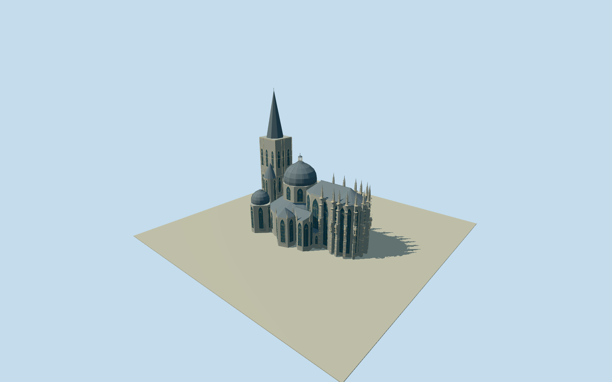

# Aachen Cathedral

Complete intrinsic surviving cathedral from21native building parts:74mwesternspire/49mwestwork/flanking turrets,16-sidedambulatory/octagonalupperdrum/currentcurveddome/openlantern, tallglazedGothicchoir/apse withstone tracery/buttress-pinnacle systems/representativestatues/openparapets, allnamedsidechapels/entryvestibule/upperlink and boundednorthwestinfill. Current QuallaCC0exterior plus primary historical plan relationship only. No separatecloister/treasury/townhall/houses/siteplaza/ground/interiors/copiedphoto/signage.

Authoring state: **review-in-qa.json**. Current completion evidence is in [qa.json](qa.json) and the [completion ledger](../../../../qualla-structures/batches/qualla-002.PROGRESS.md).

- [Aachen Cathedral](https://qualla.com/aachen-cathedral/)

Original named cathedralway20470246/Q5908and21native building-part footprints identify the complete main church, independent of the surrounding cloister/dependencies. Native vertices and source height/min-height/roof-shape/roof-height tags are preserved. Parts include westwork/spire/turrets,16-sided ambulatory, upper chapel drum/current dome, Gothic rectangular/polygonal choir and named side chapels. The whole cathedral perimeter is never substituted by a generic filled block. Primary mapped values are not a certified elevation survey; minor roof/lantern sections, tracery/figures and concealed facade census are photo-informed estimates.

Exactly two native published Qualla originals: current2026KaapbijSneeuw creatorCC0east exterior and Dehio/Bezoldplate40/1887-1901primaryPD-old-auto-expired/deathyear1934. Both nativeSHA1matched/actually inspected. Historical lower-left floorplan only; its upper conjectural Carolingian reconstruction is NOT used for surviving roofs. Indooraltar/artifacts/uncertain or attributionimages excluded. No external image/generatedbitmap/copiedphototexture.

All21native component footprints and their sourceheight/min-height/roofshape/roofheight controls retained in the master. Completecompound church, not an overall footprintblock. Unknown small south-choirconnector is estimated10m/gable2m; unassigned thin northweststrip follows original mainperimeter with estimated13meave/20mridge. Separatecloister/treasury dependencies excluded.

Photo-informed detailed characteristic forms include closed pointed stained-glass interpretations/originalleadgrid, carvedmouldings/rose-tracery,13native-front choirbuttresses with interpretedstagedsections/creamquoinbands, pinnacles/representativeoriginalrobedstonefigures and openupperparapets. Exact tracery/artwork, statue identity/pose/census, concealedfacades, windowcounts and currentconservation are not a measured replica. Closed portable glazing uses a colored opaque approximation.

Current centralcurvedroof and openlantern are interpreted within nominal42msourceheight; smallcrosses extend slightlyabove nominalroofheights. Domecurve/lanternsections, leadseams, finials and roofjoins are not surveyed. Nativeupperbridge retains25mminimumheight and smallestimated.6mgable; supporting adjacent architecture remains separate.

Independent180mrawTerrariumfield frozenbeforegeometry atwesternapproach. Source grid/PNG/originaltile unchanged; no groundflattening/fitting. Thresholds/hidden foundations/host contact approximate; flatviewerstage is not gradecertification. No naturalground/publicsquare included. Detaillevels simplifycurvefacets/tracery/sculpture while compound massing/choir/dome/spire and openlanternpersist.

Build: `node packages/worldgen/scripts/generate-authored-places.mjs --ids=aachen_cathedral`. Add `--check` to verify exact regeneration. 42793 triangles; 6 materials; no embedded photographs.
