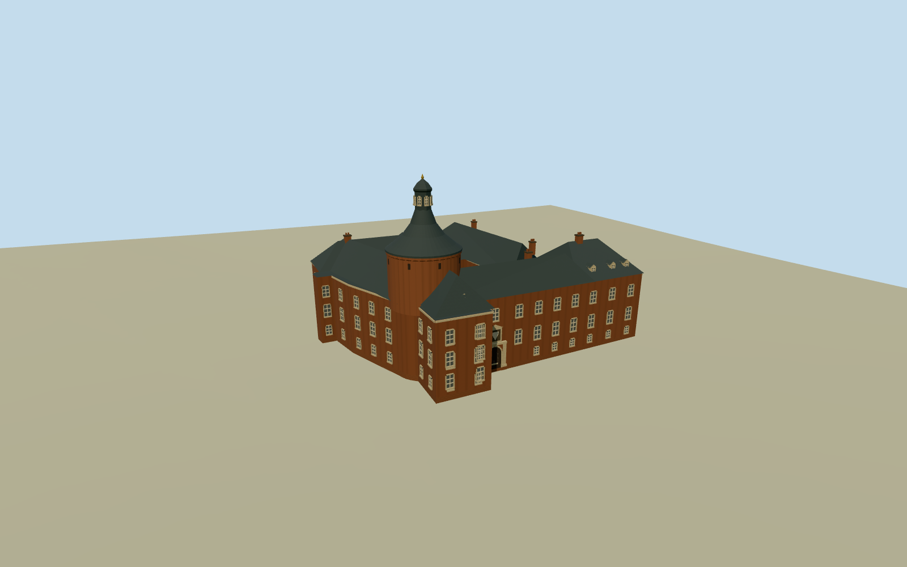

# Anholt Castle

The Hauptburg of Wasserburg Anholt, with four brick ranges wrapping an open courtyard, slate roofs and the circular medieval Dicke Turm.

Authoring state: **review-in-qa.json**. Current completion evidence is in [qa.json](qa.json) and the [completion ledger](../../../../qualla-structures/batches/qualla-004.PROGRESS.md).

- [Anholt Castle](https://qualla.com/anholt-castle/)

Only the northern Hauptburg is represented. The neighboring Vorburg, moat bridges, park and historic rooms remain outside this asset.

The outer and inner map rings and documented keep diameter control plan proportions. Heights, window bay spacing and secondary carving are photo-based estimates.

The native terrain supplies exterior contact elevations. Water surface and independent neighboring buildings belong to the world context.

Build: `node content/worldgen/source/places/u1/u1h/anholt_castle/models/generate-anholt-castle.mjs`. Add `--check` to verify exact regeneration. 14647 triangles; 6 materials; no embedded photographs.
