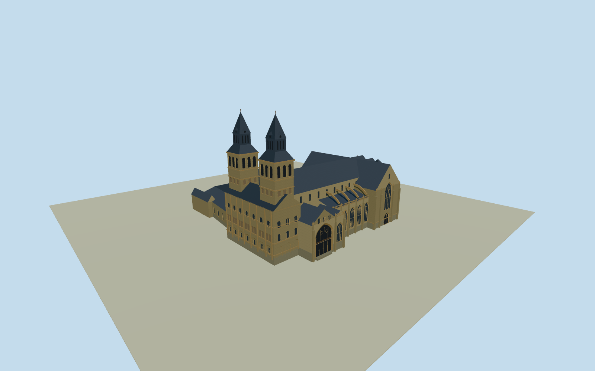

# Basilica of Saint Servatius

Maastricht limestone and dark sandstone basilica with paired west spires, a glazed Gothic Bergportaal, steep slate roof, arcaded east apse and adjoining cloister.

Authoring state: **review-in-qa.json**. Current completion evidence is in [qa.json](qa.json) and the [completion ledger](../../../../qualla-structures/batches/qualla-003.PROGRESS.md).

- [Basilica of Saint Servatius: An Armenian Bishop's Grave in the Low Countries](https://qualla.com/basilica-of-saint-servatius/)

Model represents standing exterior and open cloister courtyard. It excludes the adjacent Sint-Janskerk.

Westwork heights follow the recorded measurements and photo silhouette. The apse, small towers, cloister, details, facade finishes and vertical terrain contact are approximate.

Crypt, treasury interiors and relief carvings are outside the exterior scope.

Build: `node content/worldgen/source/places/u1/u1h/basilica_of_saint_servatius/models/generate-saint-servatius.mjs`. Add `--check` to verify exact regeneration. 23600 triangles; 5 materials; no embedded photographs.
