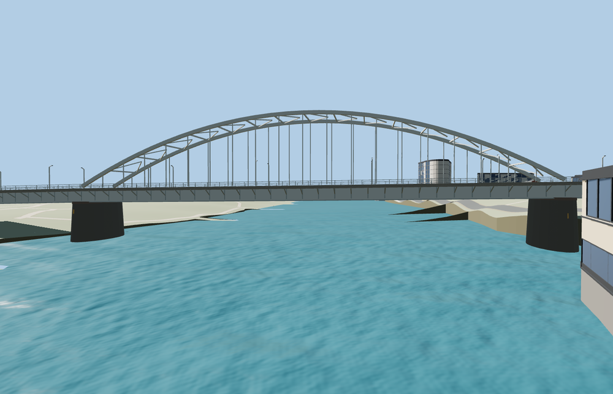

# John Frost Bridge

The full Arnhem crossing with paired off-white steel arches, straight vertical hangers and overhead K bracing, two deep continuous girders, pointed granite river piers, red cycle decks, and the two tower-and-stair approaches.

The source master has 15,916 triangles. The skyline, district, street, and close-up tiers have 980, 3,540, 12,436, 15,532 triangles. The first two tiers total 347,420 bytes. The close-up tier is 1,216,452 bytes. Six GLBs passed validation and 34 current views were inspected.

All four tiers pass 18 roadway and cycleway joins and 24 approach checks within 0.15 m. The largest approach difference is 0.006 m. Twelve lower route and three river centerline probes show zero obstructions at their test heights. The river probes measure at least 14.023 m of rendered headroom. The viewer retains 42 mapped lower route parts and all 87 neighboring buildings. Model unload and failed-load fallback both passed.

The 603.402 m mapped footprint and the traced roadway and cycleways locate the bridge. The heritage register sets the 120 m arch span, 17.5 m rise and flanking 50 m spans. The deck grade, approach pier spacing and visible stair profiles adapt the standard terrain and ordinary photographs. The north lower access retains its separately mapped connector. The lowest floodplain path has 2.268 m rendered headroom. The local fixture has tile edges and uses approximate terrain and river levels. Physical-device timings and surveyed clearances remain unmeasured.

Rebuild with `node packages/worldgen/scripts/generate-john-frost-bridge.mjs`. Append `--check` to compare exact output bytes. Use `--ids=john_frost_bridge` for targeted import, LOD, placement, and readiness. The generator is registered in asset-build.json.
