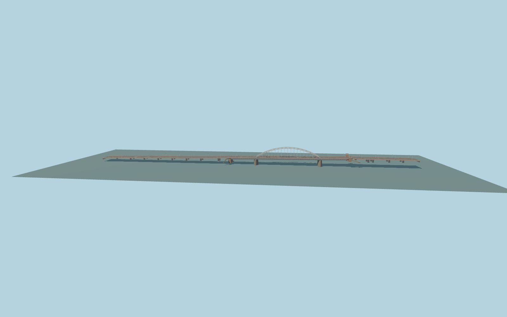

# John Frost Bridge

The full Arnhem crossing with paired off-white steel arches, straight vertical hangers and overhead K bracing, two deep continuous girders, pointed granite river piers, red cycle decks, and the two tower-and-stair approaches.

Run `node packages/worldgen/scripts/generate-john-frost-bridge.mjs` to rebuild the source master. Append `--check` to compare the exact bytes. Use `--ids=john_frost_bridge` for targeted import, LOD generation and placement.

The mapped outline, carriageway and cycle traces determine the frame. The 50 / 120 / 50 m girder spans and 17.5 m arch rise follow the heritage register. Photos guide the viaduct piers and stair geometry.

Deck and lower access elevations use standard Terrarium terrain. The model depicts the visible exterior, including the open tower passages.

Original geometry:repository license. Map:© OpenStreetMap contributors,ODbL-1.0;Protomaps. Standard terrain:terrain-grid.json. Ordinary pictures stay local and are not redistributed or used as textures. Current acceptance:qa.json.
