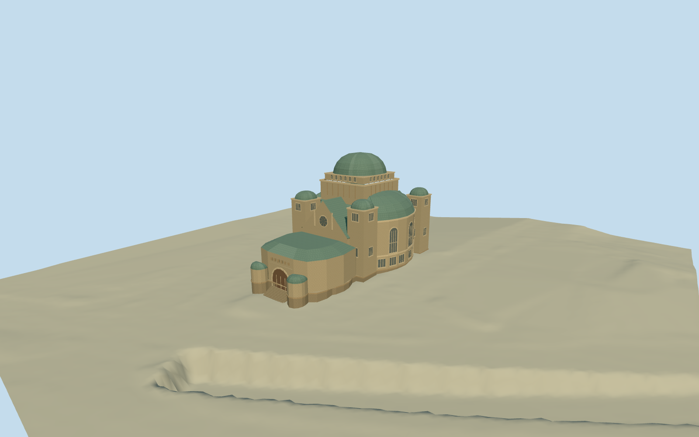

# Old Synagogue (Essen)

Edmund Körner’s domed shell-limestone synagogue, with the Steeler Tor entry and four small copper domes.

Authoring state: **review-in-qa.json**. Current completion evidence is in [qa.json](qa.json) and the [completion ledger](../../../../qualla-structures/batches/qualla-004.PROGRESS.md).

- [Old Synagogue (Essen)](https://qualla.com/old-synagogue-essen/)

Represents the permanent restored form documented by the city. Temporary construction scaffolding, the removed outer forecourt arcade, the separate rabbi’s house, and interior exhibits are outside the building model.

Masses, openings and architectural hierarchy follow the original elevations and native surveyed outline. Individual ashlar joints and fine tracery are representative.

Build: `node content/worldgen/source/places/u1/u1h/old_synagogue_essen/models/generate-old-synagogue-essen.mjs`. Add `--check` to verify exact regeneration. 11231 triangles; 5 materials; no embedded photographs.
