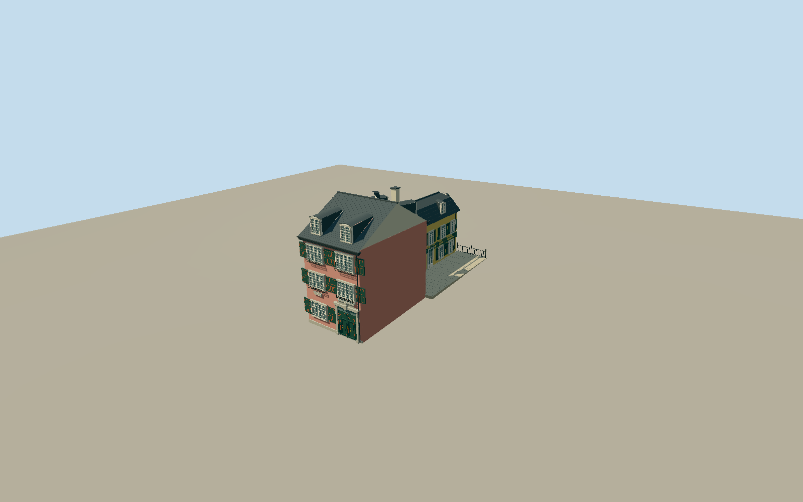

# Beethoven House

Bonngasse 20: narrow three-storey pink street facade, paired white casements and green/red shutters, carved stone portal and paneled green door, slate roof with two curved dormers; yellow rear elevation and lower garden wing with a hipped mansard roof, end windows and courtyard dormers beside the paved courtyard.

Authoring state: **review-in-qa.json**. Current completion evidence is in [qa.json](qa.json) and the [local 100 ledger](../../../../qualla-structures/batches/PROGRESS.md).

- [Beethoven House](https://qualla.com/beethoven-house/)

Original medium-fi exterior reviewed against Emil Koch street and garden photographs explicitly released CC0 by Wien Museum, official museum building history and native mapped footprint. Earlier attribution-only imagery and aerial photography are excluded from the current review. Paint colours, hidden party walls, exact dimensions, roof joins and small ornament are estimates; no surveyed plan used.

Bonngasse 20 front building, connected lower birthplace garden wing and courtyard hardscape only. Bonngasse 18, research/concert buildings, sculpture, vegetation, interiors, people and photographic pixels excluded.

Independent unmodified Terrarium ground retained. Urban elevation interpolation is not survey accuracy; host terrain may differ. Footprint replacement remains disabled.

Shutter panels, door relief, dormer caps, trellis, slate courses and garden gate are simplified progressively at distance. No physical-device performance measurement claimed.

Build: `node packages/worldgen/scripts/generate-authored-places.mjs --ids=beethoven_house`. Add `--check` to verify exact regeneration. 8103 triangles; 6 materials; no embedded photographs.
