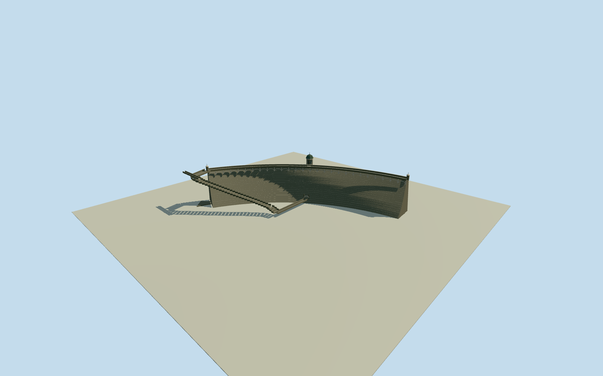

# Eschbach Dam, Remscheid (original design circa1892)

Whole Eschbach masonry gravity dam in approximate circa1892 original design appearance: complete native54-control dam wall with curved batter, full crest walkway and parapets, repeated downstream corbel arcade, central octagonal valve pavilion and roof, end turrets, intrinsic20moverflow and stepped spillway connection, and central low-level outlet. Excludes reservoir water/natural shores, remote pumpstation/pipelines/filtergrounds/roads/nearbybuildings. Historic original-design detail and actual initial completion registration are approximate, not a current2026 replacement or an exact as-built survey.

Authoring state: **review-in-qa.json**. Current completion evidence is in [qa.json](qa.json) and the [completion ledger](../../../../qualla-structures/batches/qualla-002.PROGRESS.md).

- [Eschbach Dam](https://qualla.com/eschbach-dam/)

Whole Eschbach masonry gravity dam in approximate circa1892 original design appearance: complete native54-control dam wall with curved batter, full crest walkway and parapets, repeated downstream corbel arcade, central octagonal valve pavilion and roof, end turrets, intrinsic20moverflow and stepped spillway connection, and central low-level outlet. Excludes reservoir water/natural shores, remote pumpstation/pipelines/filtergrounds/roads/nearbybuildings. Historic original-design detail and actual initial completion registration are approximate, not a current2026 replacement or an exact as-built survey.

Exact original1891drawings show proposed completion appearance, not an independent asbuilt photograph. Crest/tower/roof/ornament/grade/dimensions and historical registration estimated explicitly. Monochrome is not calibrated stone/metal colour.

Original1911Wegmann engineeringbook gives Remscheid25mheight,4mcrest,15mbase and125mplanradius as text; adjacentFig30isUrft and is not used as Eschbach image.

Natural reservoir/streambed/terrain and remote works excluded. Intrinsic overflow/cascades/outlet retained with estimated hiddensections and inletconnection.

Acquire independent original full field before all mainnumeric parameters; never flatten/cutout/refit the field for renders.

Whole54control native masonrydam base follows actual outline, not reservoir25837029. Upper mainbody uses a fitted135.17mradius/4mcrest from native plan with originaldesign gravitysection; primary1911text125mradius, actualnativeandhistoricalregistration differ. Shape and absolutegrade are bounded estimates, not a survey.

Historical circa1892originaldesign drawing includes octagonal centralvalvepavilion and pointedroof/finial, endturrets, thin stoneparapets/coping and downstreamcorbelarcade. Finalasbuilt ornament continuity, exactbaycensus/heights/finish are estimates; monochrome stone/roof colours not measured.

Independent current hostDEM absolute231.3272..283.4193m at247.0773mdatum retained unmasked. Field is too coarse to recover original downstream valley or inundated foundation, so25mstructure is positioned relative to chosen hostdatum; absolutehistoriccrest/reservoir level and foundation contact notcertified. No artificial reservoir/landscape to conceal source mismatch.

Original20mweir retained with estimated5.6mwide32stepchannel along actualoverflowdrainage. The drawing establishes full intrinsic scope, while hidden inlet connection/stepcount/wallheights/outletportal and underwaterparts are estimated. Remotefiltergrounds,pumpstation,pipelines and unrelatedroads excluded.

FourLODs retain full wall/crest/pavilion/endturrets/overflow/outlet. True masonrybody sections, closed roof undersides and pavilionrecesses are geometry; no phototexture/people/trees/art/waterplane or remotebuilding proxy.

Build: `node content/worldgen/source/places/u1/u1j/eschbach_dam/models/generate-house.mjs`. Add `--check` to verify exact regeneration. 16906 triangles; 6 materials; no embedded photographs.
