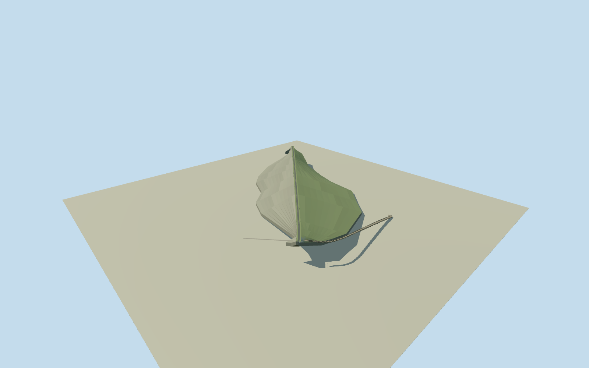

# Sorpe Dam — Sundern

Whole Sorpe main dam and its connected defining flood-relief cascade: complete rockfill embankment with concrete core, original mapped land-side perimeter and full linked700m crest paths, upstream closure, crest paving/edge fittings, intake link, all37stepped masonry spillway basins along the mapped curved cascade and lower stilling termination. Dam69m above deepest core foundation/60m abovevalley,307mmaximumfoot/10mcrest and700mcrestlength from owner; full original native controls preserved. Exact submerged upstream footprint, core/abutment section variation, crest absolute grade, basin divisions/walls/fittings/finish are explicit reconstruction estimates. Detached powerhouse, service buildings, reservoir landscape, distant Amecke foredam and unrelated roads are separate structures, excluded. No imagery used or photographic fidelity claimed.

Authoring state: **review-in-qa.json**. Current completion evidence is in [qa.json](qa.json) and the [completion ledger](../../../../qualla-structures/batches/qualla-002.PROGRESS.md).

- [Sorpe Dam](https://qualla.com/sorpe-dam/)

Whole Sorpe main dam and its connected defining flood-relief cascade: complete rockfill embankment with concrete core, original mapped land-side perimeter and full linked700m crest paths, upstream closure, crest paving/edge fittings, intake link, all37stepped masonry spillway basins along the mapped curved cascade and lower stilling termination. Dam69m above deepest core foundation/60m abovevalley,307mmaximumfoot/10mcrest and700mcrestlength from owner; full original native controls preserved. Exact submerged upstream footprint, core/abutment section variation, crest absolute grade, basin divisions/walls/fittings/finish are explicit reconstruction estimates. Detached powerhouse, service buildings, reservoir landscape, distant Amecke foredam and unrelated roads are separate structures, excluded. No imagery used or photographic fidelity claimed.

Primary owner technical table gives69m above deepest core foundation,60m above valley,307m greatest foot width,700m crest/10m crestwidth and rockfill/concrete-core/clay construction. Original crest path is696.81m; native controls preserved without stretching to approximate700m. Original dam polygon maps exposed land-side area; underwater upstream outline and changing abutment sections are estimated, not native measurements.

Owner2022annual-report cached search extraction specifies37masonry stepped basins,66m drop, approximately350m curved length,6–18m basin lengths and3–7m channel widths. Exact step census retained with declared division, wall-height and fitting estimates. Original open mapped channel356m retained; published approximate length not forced. Short buried intake link recorded, internal tunnel profile not shown.

Approximate285m crest absolute level is a visualization estimate, informed by local nature-park published285mNN and owner283.03mNHN reservoir level; source-provider, NN andNHN datum relation is not certified. Terrain has large canopy/coarse-DEM offsets along the thin crest. Original field stays unchanged even where it buries model surfaces. No terrain fitting/masks/cutouts/re-acquisition or surveyed ground-contact claim.

Full physical dam and connected spillway retained. Detached powerhouse/service buildings, distant foredam and reservoir/forest landscape are separate structures excluded. Surface finish, submerged profile, minor fittings, basin partition lengths, abutment taper and section variation are explicitly estimated; no photographs/figures/drawings used and no photographic fidelity claimed.

Build: `node content/worldgen/source/places/u1/u1j/sorpe_dam/models/generate-house.mjs`. Add `--check` to verify exact regeneration. 8044 triangles; 6 materials; no embedded photographs.
