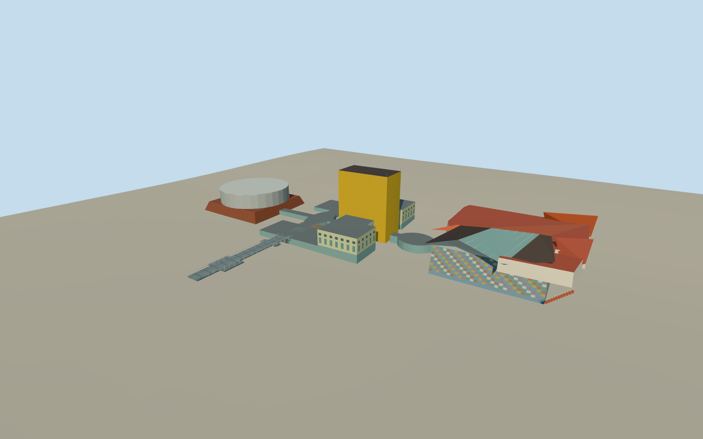

# Groninger Museum

Groninger Museum’s 2015 exteriors on the canal island, with its circular west gallery, gold entrance tower, and folded metal and glass on the east.

Authoring state: **review-in-qa.json**. Current completion evidence is in [qa.json](qa.json) and the [completion ledger](../../../../qualla-structures/batches/qualla-003.PROGRESS.md).

- [Groninger Museum](https://qualla.com/groninger-museum/)

The asset shows the museum’s 2015 canal-side exterior, including four architectural pavilions and the nearest bridge span. Interior and temporary exhibition displays are excluded.

Pavilion heights, grades and the eastern folded panels are approximated from documented footprints and photos. Patterns are represented with procedural color and material variation. No photographic art or logos are included.

Build: `node content/worldgen/source/places/u1/u1k/groninger_museum/models/generate-groninger-museum.mjs`. Add `--check` to verify exact regeneration. 4188 triangles; 5 materials; no embedded photographs.
