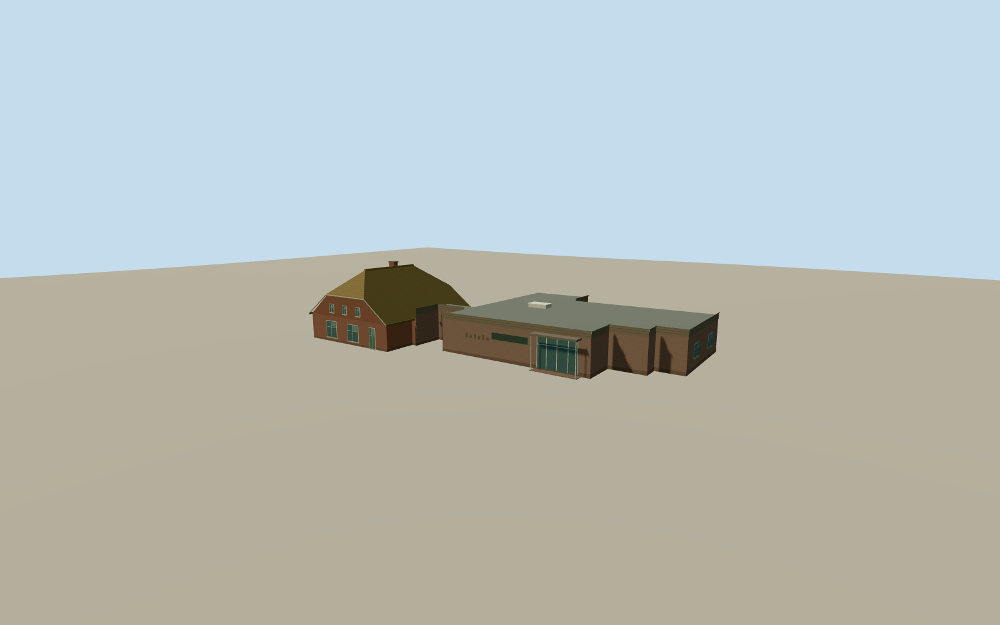

# Museum Collectie Brands

The thatched Brands farmhouse and its low, flat-roofed museum wing at Herenstreek in Nieuw-Dordrecht.

Authoring state: **review-in-qa.json**. Current completion evidence is in [qa.json](qa.json) and the [completion ledger](../../../../qualla-structures/batches/qualla-003.PROGRESS.md).

- [Museum Collectie Brands](https://qualla.com/museum-collectie-brands/)

The building represents August 2024 at the verified Herenstreek address. The story point lies about 1.8 km to the north. The farmhouse roof profile, hidden windows and rear doors are approximate.

The museum exterior is based on a cleared Qualla rendition of the photographer’s CC0 original. The original elevation field is preserved and individual entrance heights are approximate.

Build: `node content/worldgen/source/places/u1/u1k/museum_collectie_brands/models/generate-museum-collectie-brands.mjs`. Add `--check` to verify exact regeneration. 702 triangles; 5 materials; no embedded photographs.
