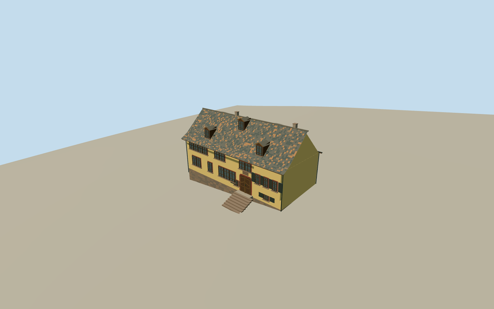

# Bach House (Eisenach)

Historic Frauenplan 21 house with ochre plaster, irregular red-bordered casements, projected upper west room, carved double door, steep weathered tile roof, three front gabled dormers and five rear shed dormers. Modern museum extension excluded.

Authoring state: **review-in-qa.json**. Current completion evidence is in [qa.json](qa.json) and the [local 100 ledger](../../../../qualla-structures/batches/PROGRESS.md).

- [Bach House (Eisenach)](https://qualla.com/bach-house-eisenach/)

Original medium-fi exterior from two primary and three supplemental individually inspected Qualla originals, official museum history and aerial/map control. Hidden ends, exact dimensions and the small rear projection remain photographic estimates; no surveyed plan.

Surviving historic house only. The timber frame is plastered, so no exposed frame grid is invented. Contemporary museum extension, neighboring buildings, garden landscaping, interiors and photo pixels excluded.

Roof weathering, curved tile profiles, leaded glass, door carving and iron grilles are authored approximations. Small ornament is simplified with distance; no exact lettering reproduced.

Independent unmodified Terrarium ground retained; urban interpolation is not survey accuracy and host terrain may differ. Footprint replacement disabled. No physical-device performance measurement claimed.

Build: `node packages/worldgen/scripts/generate-authored-places.mjs --ids=bach_house`. Add `--check` to verify exact regeneration. 25937 triangles; 6 materials; no embedded photographs.
