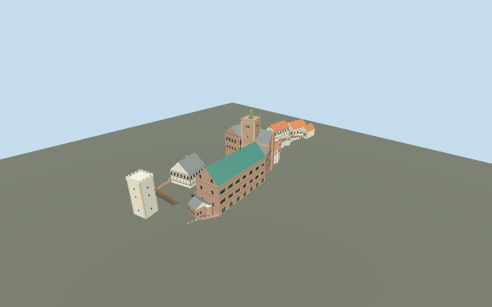

# Wartburg

The long two-court Wartburg complex: Romanesque Palas with green copper roof and grouped round-arched windows; sandstone Bergfried and gilded cross; white South Tower; half-timbered Gadem, Vogtei and Ritterhaus; bent covered galleries, open gate passages, Neue Kemenate and Ritterbad.

## Evidence and reconstruction

Published dimensions and reconstructed details are separated in spec.json. Primary references:

- [Reference](https://www.openstreetmap.org/node/2272817622)
- [Reference](https://www.wartburg.de/lageplan)
- [Reference](https://www.wartburg.de/gebaeude/bergfried)
- [Reference](https://www.wartburg.de/objekt-des-monats-archiv/das-kreuz-auf-dem-bergfried)
- [Reference](https://commons.wikimedia.org/wiki/File:Wartburg-Courtyard.01.JPG)
- [Reference](https://commons.wikimedia.org/wiki/File:Eisenach_Wartburg_18.JPG)
- [Reference](https://commons.wikimedia.org/wiki/File:Eisenach_Wartburg_17.jpg)
- [Reference](https://commons.wikimedia.org/wiki/File:Wartburg_Vogtei.jpg)

No third-party geometry, photograph or bitmap texture is embedded. Shared surface graphs come from the central library; vertex tints carry model colors. Glazing uses PBR materials; transparent surfaces are declared per model.

## Model and axes

23,028 triangles; 42,338 vertices; 8 material groups; 1,805,172 bytes. Native bounds: -60.471, -11.279, -31.111 to 91.503, 36.700, 25.458. Source hash: `sha256:454ebff90f26342831c28192c85b7123db0815f25655df82d704a04b48cb0354`.

{"up":"+Y","longitudinal":"+X from Suedturm toward Torhaus (north)","front":"+Z toward eastern Palas exterior","origin":"Exact Q151545 map point;Y0 relative Hofburg ground reference[-20,0]."}

Fresh exact-Q151545 node2272817622 and21 individual occupied ways match original coordinates within1.3mm. Native+X348.48deg follows South Tower to north gate,+Z78.48deg faces Palas east exterior. Both courtyards remain open and precinct replacement stays disabled. Retained Thüringen DGM1 November2022 bare-earth1mXYZ values sampled into a3m native grid establish relative contact. Y0 is court reference[-20,0] at406.905m DHHN2016,used relatively; no absolute height is imposed. Southern court declines3.3m,keep court rises2.7m,northern entrance drops5.3m. Separate range floors and long gallery gradients are photographic working reconstructions; foundations extend below the sampled hillside. The viewer must supply fine local terrain and neither model nor fixture substitutes a floor survey.

## Reproduce

Run `node packages/worldgen/scripts/generate-signature-towers.mjs --ids=N0241` (or add `--check`). The generator preserves manually edited masters by checking their baseline hashes. Import through the standard authored-model workflow with optimization disabled; then capture all QA cameras, including shared-surface views.

## Pending work

- Original detailed master18803828bytes/227673triangles remains exactly reproducible atsha256:573bd5f665c287318d5bc4323cdfdba84ca83ffc8cb37f4139dd2bfe4e2e6372 from wartburg-castle-model.mjs#wartburgStudy.build. Separate reviewed source supplies corrected ground contact,South Tower22.5m relative floor and Vogtei half-hip roof.
- Fresh exact-Q151545 node2272817622 and21 individual occupied ways match original coordinates within1.3mm. Native+X348.48deg follows South Tower to north gate,+Z78.48deg faces Palas east exterior. Both courtyards remain open and precinct replacement stays disabled. Retained Thüringen DGM1 November2022 bare-earth1mXYZ values sampled into a3m native grid establish relative contact. Y0 is court reference[-20,0] at406.905m DHHN2016,used relatively; no absolute height is imposed. Southern court declines3.3m,keep court rises2.7m,northern entrance drops5.3m. Separate range floors and long gallery gradients are photographic working reconstructions; foundations extend below the sampled hillside. The viewer must supply fine local terrain and neither model nor fixture substitutes a floor survey.
- Seven shared sandstone,lime plaster,timber,slate,ceramic tile,copper and painted-metal graphs plus opaque PBR glazing. Small carved/gold accents use common graph grain with vertex tint. Skyline bakes graph linear means into one draw; no copied photo textures or embedded bitmaps.
- Exterior medium-fi reconstruction. The3.8m cross follows owner record;34m keep top remains reconstructed because map40–46m tags conflict with owner description. South Tower22.5m meets owner more-than22m description. Eaves,bays,oriel tracery,gallery slopes and roof junctions are not surveyed as-built values. No exact heraldic lions,sculptural capitals,interiors,landscape hill or temporary works.
- Grade-source.xyz preserves exact cropped public1m samples; independent signed fixture uses3m grid. Source metadata givesNovember2022 laser capture,EPSG25832/EPSG7837,GCG2016,height accuracy.15–.30m. Open ground under roofs may be interpolated. Physical laptop/phone measurements remain pending.

This bundle follows the medium-fi standard. Medium-fi appearance and geographic fit are reviewed separately. Hash-bound visual acceptance is recorded separately after capture inspection.

## Additional geographic data

Map geometry © OpenStreetMap contributors, ODbL-1.0. Photographs and official plan linked as references only; no copied photographic textures or third-party mesh.
