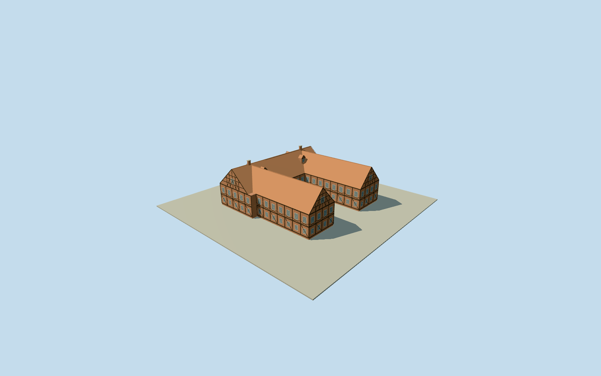

# Ahlden House

Complete native U-shaped brick/half-timber residence with east-open court, three joined steep red-tile gabled roof ranges/timbered gables/dormers/chimneys, brick western lower facade/dark oak upper and rear framing/red brick infill/white divided casements, true western vehicle and pedestrian through-arches/barrel vaults and attached sandstone heraldic relief with paired figures. Four cleared native Qualla creator originals only; sections/hidden bays/roof joints approximate. No river/park/bridge/fences/freestanding garden monuments/interiors/copied text.

Authoring state: **review-in-qa.json**. Current completion evidence is in [qa.json](qa.json) and the [completion ledger](../../../../qualla-structures/batches/qualla-002.PROGRESS.md).

- [Ahlden House](https://qualla.com/ahlden-house/)

Exact named historic castleway98004656/Q567878matches the creator Qualla rear photo linked to the same original OSM identity. Original ten-vertex U-shaped footprint retained, with east-open court and western through-gateway; no generic filled parcel or rectangle. Three roof ranges/timbered gables, brick/half-timber facades and intrinsic portal are controlled by four primary creator-released photographs. No source roof/height tags: elevations, roof intersections, window/brace/dormer census and hidden sections are explicit architectural estimates.

Four native published Qualla2008AxelHindemith/AxelHHcreatorPD-selfphotographs actually inspected and nativeSHA1matched to primary original photo-by-author/release/upload records. Exact front/rear/river-side/crest originals only; uncertain1747plan and attribution/other images excluded. No external image, generatedbitmap, copiedphotographictexture or lettering.

Exact original ten-vertex U boundary and genuine east-open court retained. Through vehicle/pedestrian archways have open front/court faces, full internal jambs/barrel surfaces and low intrinsic threshold only. Three intersecting gabled roof ranges follow native wing axes, with bounded ridge/valley joins. No courtyard/site slab or park/bridge/moat/river/trees/fences/freestanding garden statue included.

Firstfloor3.55m/eave7.35m/mainridge13.8m/sideridges13.35m/gateway3.4m/smallarch2.68mare photograph-informed section estimates; native map has no height tags. Tree-obscured window/brace/dormer/chimney census, historical timber joints, minor conservation and concealed roofdetails are interpreted. Representative dark oak framing/brick and selected herringbone-like fields/white divided casements reflect the native photos.

Attached heraldic panel uses original simplified sandstone shield/crests/paired robed figures/scrollwork, rather than copied coat-of-arms imagery or inscription. Closed portable glazing is an opaque color approximation. Hidden interiors/auction exhibits excluded. Decorative frame depth and fine brick/framing detail simplify with distance while both passage voids and the open court persist.

Independent160mrawTerrariumfield frozenbeforegeometry at fixed western gateway approach. Original source tiles/grid/PNGunchanged, not flattened/fitted; source urban/riverbank/bridge sampling may not match exact pavement. Thresholds/footings/host contact approximate; flatstage is an inspection surface, not geographic grade certification.

Build: `node packages/worldgen/scripts/generate-authored-places.mjs --ids=ahlden_house`. Add `--check` to verify exact regeneration. 6443 triangles; 6 materials; no embedded photographs.
