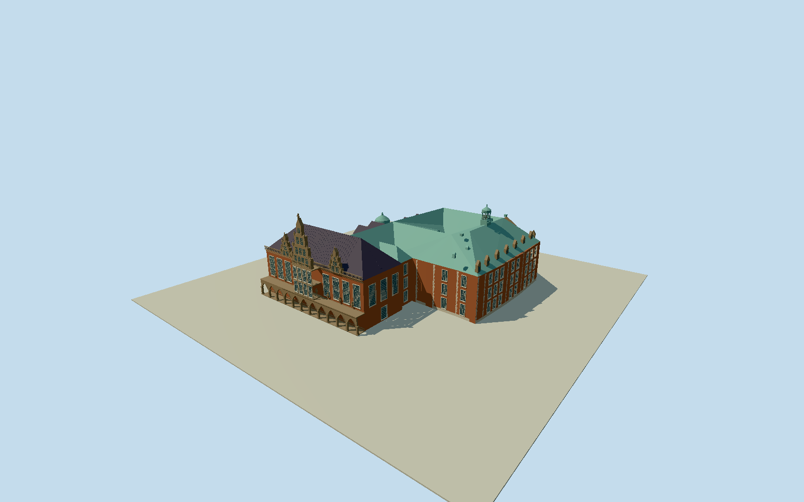

# Bremen City Hall

Whole surviving physically attached Bremen Old and New Town Hall: complete old hall and hipped dark roof, eleven open market arcade bays, upper hall tall mullioned windows, eight coarse attached Gothic figures, projecting two-storey central oriel, large central and two smaller sculpted Renaissance gables/balustrades/finials; old hall end walls/pointed windows/entrances; full offset New Town Hall with native L-shaped wings and genuine inner courtyard, copper hipped roof/dormers/open roof lantern, north rounded projecting oriel/pediment, western repeated crossgables/rounded onion-roof stair turret/low connector. Exclude separate Roland, Town Musicians, detached herald statues, churches/cathedral, parliament, whole square/streets/paving/natural ground and underground Ratskeller interior. Native full old/new body/innercourtyard/roofnetwork before geometry; preserve eleven openpointedarcadebays/threefrontgables/greennewhallhippedroof/dormers/squareopenlantern/northroundedprojection/westroundonionstairturret. Recesswindows physically with wallpanels/reveals; no opaque sheet hidingarcade or courtyard. No wholebuildingrectangle simplification. Approximate hiddenroof valleys/fine tracery/stone relief/room interiors from clearoriginals; levelindependent2mgroundfield frozen before geometry. Groundcontact remains uncertified unless matched to livehost.

Authoring state: **review-in-qa.json**. Current completion evidence is in [qa.json](qa.json) and the [completion ledger](../../../../qualla-structures/batches/qualla-002.PROGRESS.md).

- [Bremen City Hall](https://qualla.com/bremen-city-hall/)

OSMrelation2190791/Q19479 complete original multipolygonouter374370995 and inner164225490, distinct from wider UNESCOsite/Roland. Native buildingrelation2805358 provides oldhall374370982/connector374370979/centeroriel208622388/twosmallerfrontgables374371003/374371028, fullnewroofbody225552770, westernwing/stairturretparts and roofedge/ridgeline graph. All original plan vertices preserved as controls; tiny attached detail offsets simplify by detail level. Native roofheight28moldhall expressly estimated from shadow and other unsourcedverticaltags are approximate, not measured survey; observedphoto proportions bound roof/gable/lantern heights. Complete inner lightwell stays genuinely open. Fixed+XSEalongmarketarcade/+ZSWtowardmarket before terrain/geometry.

Whole attached Old/NewTownHall; separateRoland/TownMusicians/heralds/churches/parliament/marketstreet/paving/naturalground and undergroundinteriors not modeled. Nativefullphysicalouter/innercourtyard/parts/roofgraph retained. Mainfacadeeleven truepointedarcadebays/two-storeycentraloriel/threeRenaissancegables; lowerdetailedlevels simplify windowrecess/figures/pinnacles/dormers. Sculptures/coatsofarms/inscription/tracery are coarse abstractions, not precise individual portraits.

Seven exactnativecreatorCC0originals: startpublishedQuallaZairon2009front, thencurrent2026LeonhardLenzsixviews. NativeSHA1/revisions/ownselfCC0grants bound. No attributionlicensed/questionablephotos or localmediarepairs. Currentdarkgrayoldroof overrides2009green; attachednewroofgreen. No photo textures/generatedbitmap.

Nativeoldroof28m/14mrise expressly estimatedfromshadow; roof/gable/lantern heights conservativelyphoto-bounded22.5mold/newmainhips/~29mornamentlantern; not asurvey. Facetgraphroofvalleys/hiddenreardetail/precisereliefandwindowcensus estimated. Roofseamsandfinejambs simplify atdistance.

Independent256m129²16641samplefield/oneoriginalTerrariumtile frozen before geometry; source range14.6587..23.3836m/fixedapproachdatum17.0043m. Output2.87mspacing/2mreviewgrid mayoversamplecoarseurbanDEM, notsurveyclassificationorbuildingthresholdgrade. Originalgrid/heightfield/rawtile unchanged. Flatreviewfixtures; actualhostgroundcontactunverified, geographicpreview/replaceFootprint=false.

Build: `node packages/worldgen/scripts/generate-authored-places.mjs --ids=bremen_city_hall`. Add `--check` to verify exact regeneration. 62933 triangles; 5 materials; no embedded photographs.
