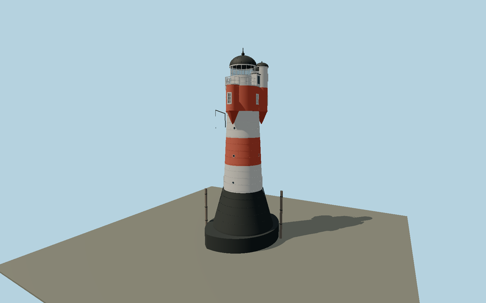

# Roter Sand — roter_sand

Offshore riveted taper with black plinth, white/red/white shaft, red service room and three unequal-height round bays; white lantern, black domes, scalloped gallery, portholes, rivets, ladders, davit and mooring dolphins.

## Identity and evidence

Exact catalog identity **Q220034**. Source facts: `{"survey":"GMG GA218014, 14 June 2019, section 1.02 pp I-5–7; field visits October 2018 and May 2019","plinthHeightMeters":6.1,"plinthDiametersMeters":[10.1,6.4],"shaftHeightMeters":12.7,"shaftDiametersMeters":[6.4,5.1],"bayDiameterMeters":1.9,"bayBearingsDegrees":[180,292.5,45],"lanternDiameterMeters":4,"baseLadderRungs":19,"aboveLowWaterMeters":30.95,"verticalDatum":"GMG III-9 uses low water = NN -2.05 m; tower tip NN +28.90 m","originalMasterHash":"sha256:266c5b5a60e6815673ecd1dc2e0de61dab764367c46e5cb26b5549878207a5ce","reviewedCaisson":{"circleRadiusMeters":7.3,"circleCenterSeparationMeters":3.6,"longAxisBearingDegrees":157.5},"bayExposedArcDegrees":270,"basis":"2018–2019 surveyed offshore exterior. Above-water caisson is reconstructed from two7.3m-radius arcs with3.6m circle-center separation, approximately11x14m; bay offset is reconstructed from published1.9m diameter/270-degree exposed arcs and5.1m central service-room diameter. These rounded facts are not a fabrication survey. Exact corrosion/fasteners, submerged caisson, hidden interior and operating optics excluded. Static viewer water zero approximates historical NN; local floor datum−2.05m is explicit and no tide/datum conversion is claimed. The owner2026 chronology proposes relocation but does not document a completed move."}`. The source specification keeps published dimensions separate from reconstructed details.

- https://www.denkmalschutz.de/fileadmin/media/Bilder/Denkmal/Leuchtturm_Roter_Sand/Gutachten_Sanierung_Juni2019.pdf
- https://urn.dsm.museum/DSA/DSA08_1985_199216_Peters.pdf
- https://www.denkmalschutz.de/denkmale-erhalten/stiftungseigene-denkmale/leuchtturm-roter-sand/chronik-und-zukunft-des-leuchturms.html
- https://www.openstreetmap.org/node/635484478

Original geometry uses published dimensional facts. Source photographs and drawings retain their rights and are not redistributed.

## Authored geometry and materials

212,672 triangles, 457,564 vertices, 4 surface groups; 19,027,084 source bytes. SHA-256: `sha256:6b3d934a537fec2e31e8710af5c01ab25d4125ded71e9827459a82ddb65a119b`. Actual bounds: -6.087, 0.000, -6.611 to 6.087, 30.950, 6.611 m.

Shared canonical material graphs with metric UV repeats in extras.molenSurface; portable glTF PBR factors and vertex colors remain. Dark recesses/lantern panels retain local fallback materials. Shared references: `matgraph:molen.worldgen.material.metal_painted` (2 × 2 m), `matgraph:molen.worldgen.material.wood_plain` (2 × 0.25 m). Model-native axes: {"up":"+Y","front":"+Z","origin":"Native+X east,+Z south; heading0 preserves the GMG survey south180/WNW292.5/NE45-degree bays, ENE67.5/WSW247.5-degree ladders and SSE157.5/NNW337.5-degree caisson long axis."}.

## Placement proposal

Native+X east,+Z south; heading0 preserves the GMG survey south180/WNW292.5/NE45-degree bays, ENE67.5/WSW247.5-degree ladders and SSE157.5/NNW337.5-degree caisson long axis. 2018–2019 surveyed offshore exterior. Above-water caisson is reconstructed from two7.3m-radius arcs with3.6m circle-center separation, approximately11x14m; bay offset is reconstructed from published1.9m diameter/270-degree exposed arcs and5.1m central service-room diameter. These rounded facts are not a fabrication survey. Exact corrosion/fasteners, submerged caisson, hidden interior and operating optics excluded. Static viewer water zero approximates historical NN; local floor datum−2.05m is explicit and no tide/datum conversion is claimed. The owner2026 chronology proposes relocation but does not document a completed move. Proposed anchor 8.0821686, 53.8531662 (longitude, latitude), heading 0 radians. Elevation policy: **sea-level**. This is a reviewable proposal, not a completed site-fit certification. Ground models require terrain contact; offshore models also require water-datum and base-height checks.

## Limitations and review

- Medium-fi exterior of the 2018–2019 surveyed offshore appearance. The original detailed master remains separately reproducible; review-scope.json selects the refined exterior and four browser derivatives.
- Caisson arcs, exposed bay joins and principal dimensions follow the rounded engineering facts. Seam/rivet spacing, porthole allocation, small fittings and battery cupboard remain reconstructions, not a fabrication survey.
- Street/close-up/master levels have real recessed circular apertures. District/skyline windows become marks; far rail and curve subdivisions reduce while retaining the complete tower. Hidden interiors, underwater foundations, exact corrosion and working lamp optics are omitted.
- Exact offshore identity and compass directions are survey-backed. Viewer water zero approximates historical NN; elevation -2.05 m is explicit, with no tidal or geodetic conversion. The owner’s 2026 plan describes a future relocation, not a documented completed move.

Near/far fixtures are in `spec.qaCameras`. Float32 finite geometry, triangle degeneracy and winding are checked by the generator. Current rendering, shared-material, maximum-fidelity and geographic review results are recorded in `qa.json` and the readiness ledger; source generation alone does not approve a model.

Regenerate with `node packages/worldgen/scripts/generate-lighthouse-models.mjs --ids=roter_sand`; add `--check` for reproducibility. Editable component recipes are in `packages/worldgen/scripts/roter-sand-model.mjs`. The generator protects artist-edited master hashes and preserves import/capture/shared-capture/QA documents.
