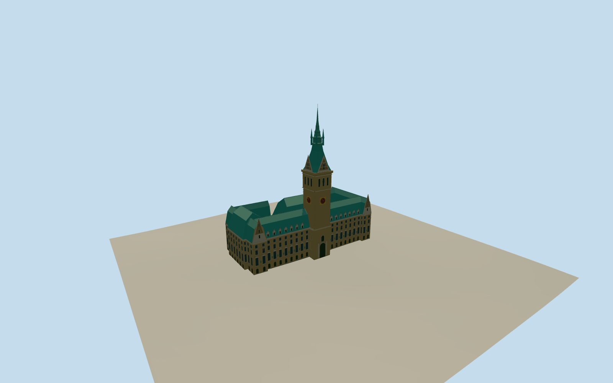

# Hamburg City Hall

Hamburg’s Rathausmarkt frontage with its sandstone window bays, green copper mansards, central gilded clocks and open Hygieia courtyard.

Authoring state: **review-in-qa.json**. Current completion evidence is in [qa.json](qa.json) and the [completion ledger](../../../../qualla-structures/batches/qualla-003.PROGRESS.md).

- [Hamburg City Hall](https://qualla.com/hamburg-city-hall/)

Hamburg City Hall is represented in its 2009–2010 exterior, including the Rathausmarkt façade, clock tower, roofs and Hygieia courtyard fountain.

The official 111 m width and 112 m tower height and mapped roof parts constrain the main proportions. Individual statues, unseen windows and small roof ornaments are simplified.

The original Terrarium samples are preserved. Plaza paving, façade thresholds and courtyard grade are approximate.

Build: `node content/worldgen/source/places/u1/u1x/hamburg_city_hall/models/generate-hamburg-city-hall.mjs`. Add `--check` to verify exact regeneration. 9639 triangles; 5 materials; no embedded photographs.
