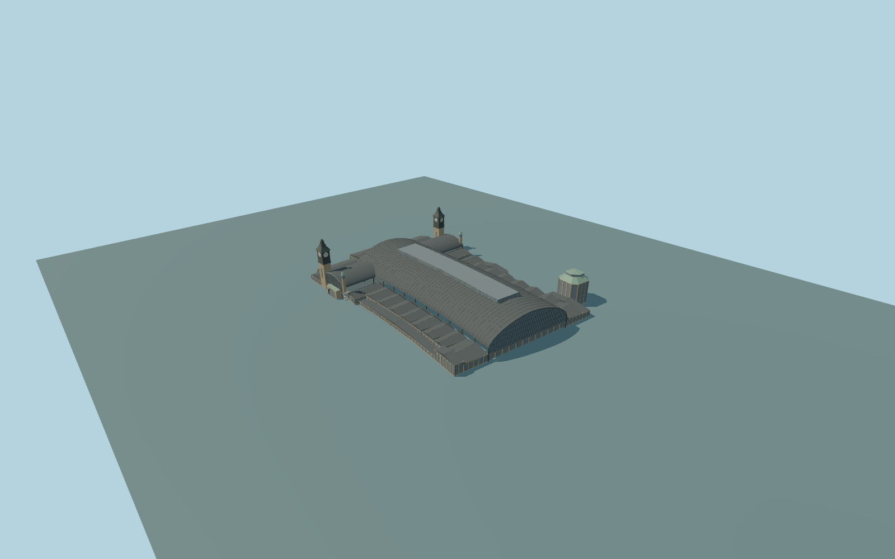

# Hamburg Hauptbahnhof

Complete connected Hamburg main-station exterior:whole curved train shed andraised glazed monitor,both full glazed arch ends,transverse Wandelhalle withboth clock towers,arched entry fronts,paired copper entrance turrets,north range,all mapped repeated pitched side bays andSSE eastern roof pavilion. Preserve thebelow-grade open rail approach,independent extended platformcanopies androad bridges,street kiosks,offices andcity blocks. Exterior only;no lettering,brands,coats of arms,people,trains,navigable interior orfuture expansion proposal.

Rebuild: `node packages/worldgen/scripts/generate-hamburg-station.mjs`;append `--check` for exact source bytes. Select import/LOD/placement with `--ids=hamburg_hauptbahnhof`. Detailed source and four browser tiers are separate ignored GLB outputs.

Complete connected Hamburg main-station exterior:whole curved train shed andraised glazed monitor,both full glazed arch ends,transverse Wandelhalle withboth clock towers,arched entry fronts,paired copper entrance turrets,north range,all mapped repeated pitched side bays andSSE eastern roof pavilion. Preserve thebelow-grade open rail approach,independent extended platformcanopies androad bridges,street kiosks,offices andcity blocks. Exterior only;no lettering,brands,coats of arms,people,trains,navigable interior orfuture expansion proposal.

Native main roof26m,raised monitor28/min26m,transverse concourse18m,twinclocktowers45m andtwo attached small entrance turrets26m,side bays8/8.5/11m,north entryrange14m,andSSE pavilion24/min4m with26.8m cap retain their explicit maxima. Parent11m is ownership height,not a full solid. Eaves,roof curvature,clock section transitions,small entrance turrets26m (explicit native maxima;section transitions estimated),floor+.65m andfoundations-8m are ordinary-photo architectural estimates. Rails are visibly below street level;do not add a flat ground floor under the shed or flatten the approaches. Layer1/2 are map facts,not surveyed grades. One common standard host datum;no per-part host offsets. One unchanged standard field sample outside the WSW Wandelhalle entry[-64,82],14.93662612m,defines commonY=0. Native contact still requires current render review.

Two ordinary aerial/entrance pictures inspected;the aerial is2013 andneither picture establishes currentconstructionphase,hidden stationdetails,exact thresholds orsupport inventory. No futureexpansion orbespoke survey/archival research. Contemporary PMTiles supplies whole native plans. Preserve detached canopies,road bridges,kiosks,offices andall external cityblocks. Exact hidden windows,thresholds,roof section/rib inventory andcurrent works remain approximate. Physical-device timing andnumerical LODerrors remainunmeasured.

Six existing shared256px graphs:stone_sandstone,stone_granite,slate,metal_copper,metal_painted andwindow_grid. Six mergedsemantic groups;metric UVs,linear colors,no private or embedded images. Real tan stone,dark slate/steel andpale copper preserve their material semantics;only actual glazing uses window_grid. Skyline preserves allhall/tower andpavilion silhouettes andsimplifies only thelow sidewingroofs by atmost2.5m. Districtadds real glass;streetadds recesses androofribs;close-up refines clocks,railings andwindowframes. Themaster separately refines roofcurves,panes,roofseams andclockdials. No copied numerals orsigns. Hidden geometry andcurrentworks remain approximate.

Original geometry:repository license. Map:© OpenStreetMap contributors,ODbL-1.0;Protomaps. Standard terrain:terrain-grid.json. Ordinary pictures stay local and are not redistributed or used as textures. Current acceptance:qa.json.
