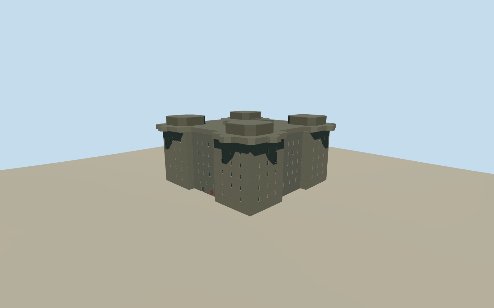

# Heiligengeistfeld Flak Tower

Hamburg’s former Flakturm IV on Feldstraße in its 2006 media-bunker appearance, with four large concrete bastions, projecting gun emplacements and rows of postwar window cuts.

Authoring state: **review-in-qa.json**. Current completion evidence is in [qa.json](qa.json) and the [completion ledger](../../../../qualla-structures/batches/qualla-003.PROGRESS.md).

- [Flak Tower](https://qualla.com/flak-tower/)

The Hamburg bunker is a dated view of the site as the media bunker in 2006. The story’s Berlin pin stays at Friedrichshain, and the linked model has its own Hamburg placement.

The present-day outline bounds the surviving concrete canopy and corner projections. Floor elevations, turret dimensions, roof utilities and some rear openings are approximate.

The pre-conversion concrete exterior is the scope. The old control tower, wartime equipment, interiors and modern rooftop hotel and garden fall outside this date.

Build: `node content/worldgen/source/places/u1/u1x/heiligengeistfeld_flak_tower/models/generate-heiligengeistfeld-flak-tower.mjs`. Add `--check` to verify exact regeneration. 6200 triangles; 4 materials; no embedded photographs.
