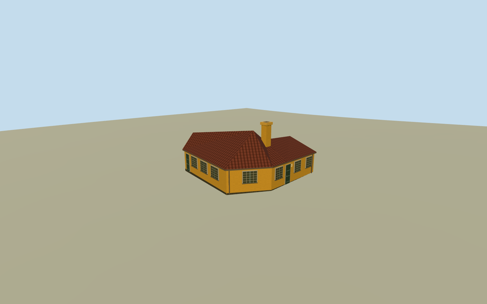

# Hans Christian Andersen’s Birthplace

The small yellow Odense birthplace with its irregular tiled roofs, multi-light sash and chamfered corner.

Authoring state: **review-in-qa.json**. Current completion evidence is in [qa.json](qa.json) and the [completion ledger](../../../../qualla-structures/batches/qualla-004.PROGRESS.md).

- [Hans Christian Andersen Museum](https://qualla.com/hans-christian-andersen-museum/)

The model represents the historic birthplace only. The 2021 Kengo Kuma museum, garden and Andersen's later childhood home are separate.

Local sill, eave and small rear openings are bounded estimates. The regional elevation raster does not resolve individual cobblestones.

Build: `node content/worldgen/source/places/u1/u1z/hans_christian_andersen_birthplace/models/generate-hans-christian-andersen-birthplace.mjs`. Add `--check` to verify exact regeneration. 486 triangles; 5 materials; no embedded photographs.
