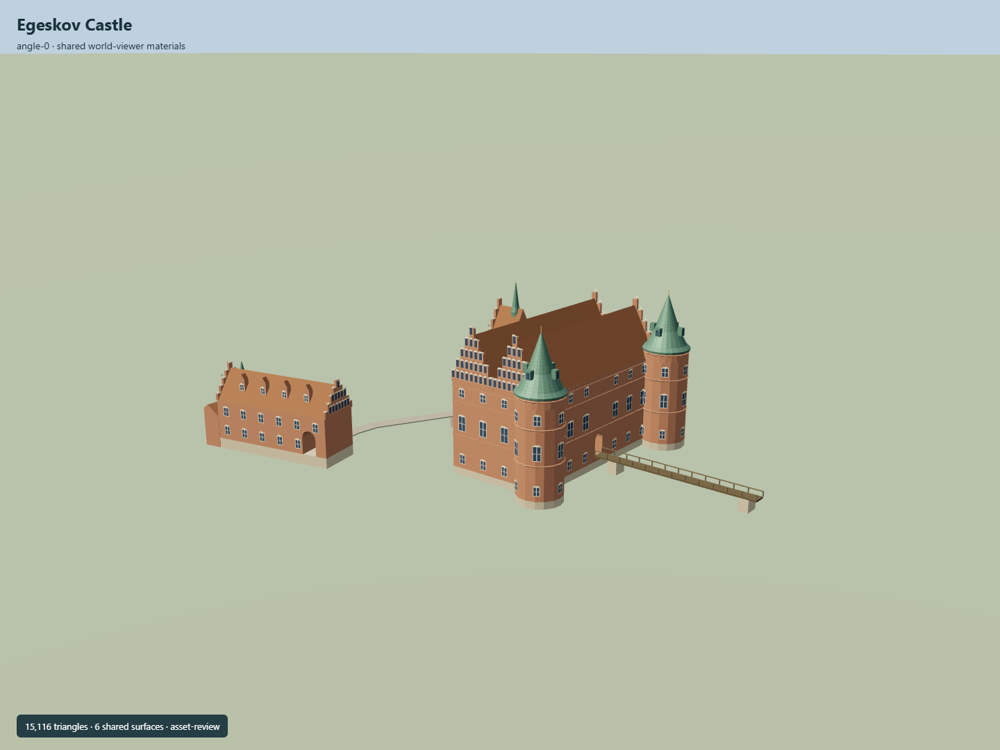

# Egeskov Castle

Twin red-brick longhouses with parallel steep red roofs and four stepped gables,two copper-helmed eastern round towers,west square clock/stair tower,current gate wing with physical arched passage,west entrance approach and east footbridge.

## Evidence and reconstruction

Published dimensions and reconstructed details are separated in spec.json. Primary references:

- [Reference](https://api.openstreetmap.org/api/0.6/map?bbox=10.4877,55.1755,10.4914,55.1772)
- [Reference](https://egeskov.dk/en/experiences/the-castle)
- [Reference](https://egeskov.dk/en/experiences/the-castle/castle-architecture)
- [Reference](https://www.danskeherregaarde.dk/nutid/egeskov)
- [Reference](https://www.danskeherregaarde.dk/uploads/egeskov-fra-luften.jpg)
- [Reference](https://www.danskeherregaarde.dk/uploads/egeskov-4.jpg)
- [Reference](https://www.danskeherregaarde.dk/uploads/egeskov-5.jpg)
- [Reference](https://www.danskeherregaarde.dk/uploads/egeskov-6.jpg)

Six existing shared256-square graphs,linear tints and central metric UV repeats. Flat glass. No embedded/new images,photo texture,downloaded model or traced printed drawing.

## Model and axes

15,115 triangles; 45,345 vertices; 7 material groups; 1,818,008 bytes. Native bounds: -62.840, -0.400, -22.635 to 43.778, 34.200, 35.210. Source hash: `sha256:a09619d2fe2fd345978838c671278e9dcebc295e7cfcf3a6f0e60884217552c4`.

{"up":"+Y","front":"West stair tower and portal; native +X east/+Z south with plan rotation baked","longitudinal":"+Z approximately south along twin longhouses","origin":"Site anchor; Y0 standard PMTiles working datum."}

The inspected aerial picture supports twin steep tiled roofs, elaborate stepped brick gables, copper-capped circular corner towers, separate gatehouse and bridges. Retained east/south mapped coordinates set approximate footprint and orientation. Standard viewer PMTiles supply coarse placement ground; reconstructed foundation and access paths are raised1m with toes extending below it, and the east bridge slopes toward its sampled shore endpoint. Actual lake waterline is supplied by host water data and is not surveyed here. Anchor 10.49020274,55.176204696; heading 0; standard PMTiles datum 63.09605669230223m. Floors are reconstructed and foundations extend below the coarse sampled ground.

## Reproduce

Run `node packages/worldgen/scripts/generate-signature-towers.mjs --ids=N0298` (or add `--check`). The generator preserves manually edited masters by checking their baseline hashes. Import through the standard authored-model workflow with optimization disabled; then capture all QA cameras, including shared-surface views.

## Pending work

- Approximate exterior and fit from inspected aerial picture and standard viewer PMTiles; no bespoke survey or exact thresholds.
- Detailed original master/hash/recipe preserved. Apertures, ornament and restoration details are interpreted; interiors and collision excluded.
- Six common graphs plus explicit glass color slot; zero embedded images. No duplicate lake/landscape geometry or water simulation; approximate shore/bridge fit only.
- Footprint replacement remains off; physical-device timing unmeasured.

This bundle follows the medium-fi standard. Medium-fi appearance and geographic fit are reviewed separately. Hash-bound visual acceptance is recorded separately after capture inspection.

## Additional geographic data

© OpenStreetMap contributors; Egeskov; Dansk Center for Herregårdsforskning.
