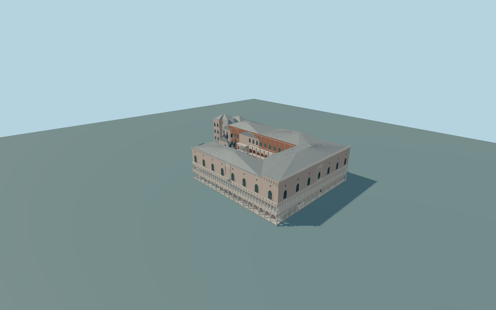

# Doge’s Palace

Complete principal Doge’s Palace exterior and attached mapped north/east range, main open courtyard, Giants Staircase/landing, both two-level open south/west colonnades and three two-level court galleries, upper pointed windows, balconies, pale sheet-metal roof ranges and Gothic parapet pinnacles. Adjacent Basilica,Campanile,Bridge of Sighs,prisons andcanals remain context.

Rebuild: `node packages/worldgen/scripts/generate-doges-palace.mjs`;append `--check` for exact source bytes. Select import/LOD/placement with `--ids=doges_palace`. Detailed source and four browser tiers are separate ignored GLB outputs.

Complete principal Doge’s Palace exterior and attached mapped north/east range, main open courtyard, Giants Staircase/landing, both two-level open south/west colonnades and three two-level court galleries, upper pointed windows, balconies, pale sheet-metal roof ranges and Gothic parapet pinnacles. Adjacent Basilica,Campanile,Bridge of Sighs,prisons andcanals remain context.

Picture-guided relative heights with retained PMTiles partheights on an approximate13m reference from the unchanged standard global Terrarium field. Venice urban DEM returns are substantially above actual tidal datum;this is approximate viewer contact,not surveyed quay or historic floor elevation. No flattening or bespoke data.

Fine relief,statues,tracery,window counts,hidden roofs andhistoric floorlevels are original approximations. No interiors,copied graphics,arms orprivate texturecopies. Four browser tiers preserve whole massing andcourt;far tiers simplify arcades/ornament. Physical-device timing unmeasured.

Six existing 256px limestone,brick,granite,painted metal,window grid andpainted wood graphs;metric UVs andlinear colors. Skyline preserves whole source massing andcourt;district coarsens open arcade rhythm;street preserves both full arcade levels withsimple frieze;close-up adds pierced quatrefoils/marble inlay/pinnacles. Source retains fine roof seams andprofiles. Error estimates3/1.5/.7/.25m andphysical timing remain unmeasured.

Original geometry:repository license. Map:© OpenStreetMap contributors,ODbL-1.0;Protomaps. Standard terrain:terrain-grid.json. Ordinary pictures stay local and are not redistributed or used as textures. Current acceptance:qa.json.
