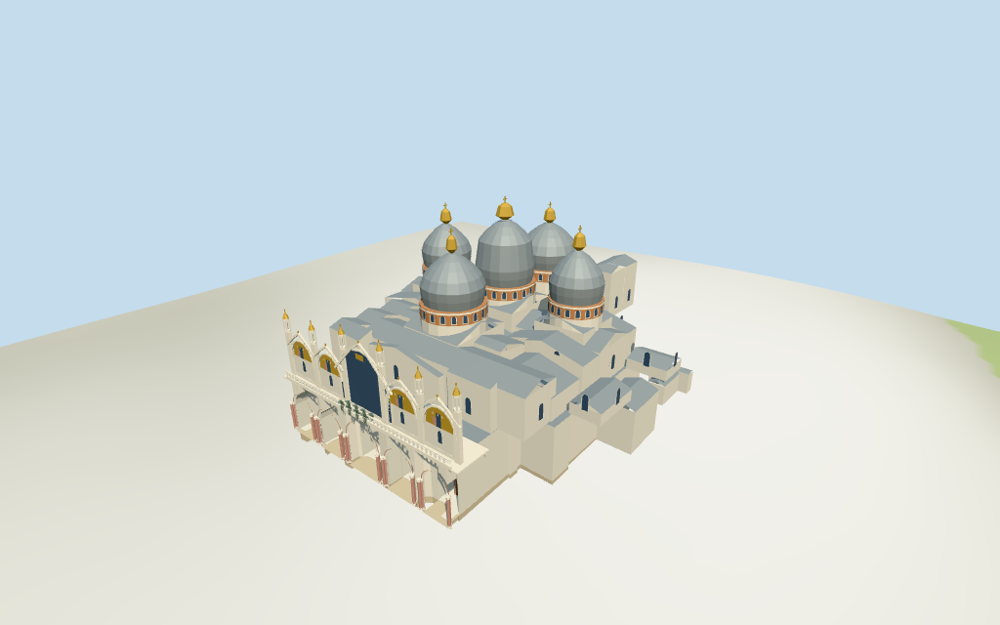

# St Mark's Basilica

Individual five-dome Byzantine basilica exterior: mapped domes/drums/crowns/roof ranges, lead-colored roofs, red brick drums, layered marble west facade with five actual narthex arches and closed rear doors, upper glazing/gold mosaic approximations, balcony/pinnacles and four simplified bronze horses.

## Evidence and reconstruction

Published dimensions and reconstructed details are separated in spec.json. Primary references:

- [Reference](https://www.vse-strani-mira.ru/architecture/architecture-italy/2365-smarka.html)
- [Reference](https://venedigtipps.de/markusplatz.html)

Four existing shared256-square graphs supply marble, brick, standing-seam metal and continuous limestone. Colors are linear; UVs metric. Glazing, doors, simplified mosaic artwork/gold and bronze horses use vertex colors, with no embedded photographs or unique facade bitmap.

## Model and axes

16,817 triangles; 50,451 vertices; 8 material groups; 2,022,512 bytes. Native bounds: -46.400, -2.701, -33.200 to 46.241, 51.200, 43.039. Source hash: `sha256:7497f13097fcf40e095cd300252587eb644bbe6b89e4786a433dce0f343292bc`.

{"x":"east toward apse","y":"up","z":"south toward adjoining palace"}

Two inspected aerial/front pictures and standard viewer PMTiles/DEM guide this individual basilica exterior. Exact thresholds/ground joins and ornament remain approximate. Detached campanile/palace, interiors and exact mosaic/sculpture excluded. ©OpenStreetMap contributors,ODbL-1.0.

## Reproduce

Run `node packages/worldgen/scripts/generate-additional-landmarks.mjs --ids=N0328` (or add `--check`). The generator preserves manually edited masters by checking their baseline hashes. Import through the standard authored-model workflow with optimization disabled; then capture all QA cameras, including shared-surface views.

## Pending work

- Mapped parent/component footprints and nominal heights control fit. Dome/crown profiles, roof subdivisions, drum window rhythm, facade arches/columns/pediments, balcony and pinnacles are picture-led approximations.
- NativeY0 follows standardDEM12.2467m at anchor. Estimated0.7m common floor, perimeter foundations and narthex/plaza joins are approximate against coarse elevation; no surveyed datum or certified walking/interior collision.
- Skyline preserves five domes/onion crowns, upper cross ranges and facade arcade/gabled crowns with simpler parts. District restores mapped ranges, shared surfaces and actual narthex cuts; street/closeup add paired columns, mosaic color panels, open pinnacles and four simplified bronze horses. Small drum/range windows are surface panes; rear entrance doors are closed.
- Four upper gold panels suggest mosaics using simple original color motifs; exact compositions, sculpture/reliefs, lettering, horses anatomy/patina, full interiors and structural roof reconstruction are excluded. Detached campanile, Doges Palace, surrounding city and vegetation remain separate host content. Physical laptop/phone measurements remain pending.

This bundle follows the medium-fi standard. Medium-fi appearance and geographic fit are reviewed separately. Hash-bound visual acceptance is recorded separately after capture inspection.

## Additional geographic data

©OpenStreetMap contributors; Protomaps; Mapzen/USGS terrain tiles.
