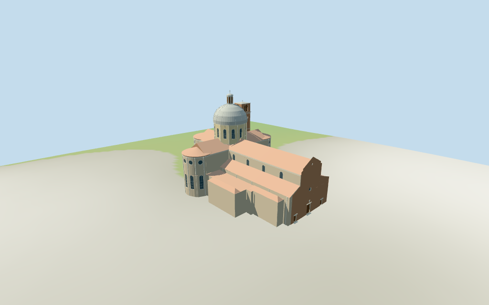

# N0407 — Padua Cathedral

Reviewed2026-10-16 against current source/runtime bytes. Accepted for the stated medium-fi exterior and approximate horizontal fit. All heights and detailed profiles are estimates; exact ground/site joins remain unverified.

## Built exterior

Inspected all11 final portable/source-terrain frames including the1024×640 summary. Individual Padua Cathedral: broad unfinished brick east entrance with three recessed timber portals, two central oculi and stepped gable; long terracotta nave/aisle roofs; three tall rounded apses with long arched windows and upper round lights; two lower western chapels; pale many-sided crossing drum and lead-colored hemisphere/lantern/cross; mapped northwest square brick campanile. Apse pilasters were moved to the architectural bay boundaries to clear the windows, a concealed low tower slit was removed, and the nave cornice stopped behind the unfinished front. Fine profiles and vertical dimensions remain estimated.

## Shared surfaces and browser levels

Inspected all11 final shared/geographic views. Six existing256² brick,raw limestone,lime plaster,flat tile,painted metal and plain wood graphs; eight merged surface groups including local blue-grey glazing. Linear tints,metric UVs and flat architectural normals; zero embedded images,unique facade photographs,bespoke textures or baked lighting. Every graph read once; unload leaves zero live model geometries. Geographic captures use flat terrain, while portable/medium-fi retain the standard viewer DEM.

| Level | Triangles | Bytes | Draws |
| --- | ---: | ---: | ---: |
| skyline | 996 | 85,024 | 1 |
| district | 3,973 | 348,152 | 8 |
| street | 15,065 | 1,406,928 | 8 |
| closeup | 21,127 | 2,030,804 | 8 |

Initial skyline plus district geometry: **433,176 bytes**. Source master: **2,539,928 bytes /21,127 triangles**; imported master: **2,539,228 bytes**. Downloads exclude shared graph definitions/runtime texture generation. Six shared256² graphs,eight merged groups,zero embedded images.

Inspected all27 final medium-fi views: Economy/High,noon/late,street/block/skyline distances,untextured silhouette,six detail cameras,four matched whole levels and four transitions. Skyline996 retains the unfinished east front,three major round apses,long nave/aisles,dome/lantern/cross and northwest tower. District3973 adds shared materials,front portals/oculi,simplified apse/clerestory/drum lights and belfry; fine pilasters,mullions,steps,slits and dome ribs enter at street15065. Close-up/master21127 refine curved sampling. Low accessory-room partitions are approximate. Italian palazzo context is synthetic. Physical phone/laptop timing and exact host-ground contact remain unverified.

## Geographic fit and limits

Anchor **[11.87124763,45.406526605]**,heading **0.135977608274rad**,approximate3° facing uncertainty; no horizontal rescale. Native+X east unfinished front/plaza,−X west apses,+Z south. Retained current church whole and tower part are distinct from the separate baptistery.

Exact retained way/131977001 and Q2407092 identify Duomo di Padova / Padua Cathedral. Current standard viewer church whole35184504065833, same-ID named POI and separate tower part35185013113163 retain73 raw outline points and all properties, alongside the earlier whole/multilingual tags. Anchor[11.87124763,45.406526605] and heading0.135977608274rad unchanged; no horizontal rescale. Native+X east unfinished brick front/plaza,−X west rear apses,+Z south. Signed facing follows the facade photograph and the separate mapped baptistery to its north. Church apse/crossing/nave/aisle partitions are picture estimates within the current envelope. Separate Battistero35184576956654 and surrounding canonical houses/palaces remain host content.

No selected map height/level tags or independent height/dimension facts. Every vertical dimension is estimated above floor0.5m: low outline/accessory ranges13.2m, aisle outer eave15.2m/inner18.8m, nave/choir/transept wall24.2m and ridge29.8m; front unfinished central gable31.3m and aisle shoulders18.8m. Three major rounded apses wall24.2m and tile crown27.5m, small western side apses13.2/15.2m. Crossing drum26.8–38.8m, lead-colored dome49.7m, lantern55.8m and cross57.8m. Northwest campanile has shaft40.3m, belfry41.7–47.4m, shallow cap48.2m and vane49.3m. Details, bays, exact roof/apse profiles and hidden partitions are approximate.

Standard viewer DEM datum21.225210m; selected perimeter-0.53 to1.20m relative to it. Floor0.5m; adaptive footings crossY=0 and extend below retained samples. No flattening, cutout or road replacement. Exact plaza/pavement, thresholds, steps, adjoining-house and baptistery joins, altitude and walking remain unverified.

Standard viewer DEM datum **21.225210m**,selected perimeter **−0.53 to+1.20m** relative to it; floor0.5m. Adaptive footings reach below retained samples. Precise pavement/plaza,threshold,steps,canonical-house/baptistery and base joins,altitude and walking remain unverified. Geographic captures use flat terrain; portable/medium-fi retain standard DEM. No flattening,cutout or road replacement.

All78 viewer-footprint checks cover the church whole and tower,and preserve Battistero35184576956654 plus seven other mapped host footprints,east plaza,north lane and west lane. Raw73 map points/properties and earlier whole/tags are retained separately from estimated facade/roof/apse/drum partitions. Italian palazzo neighbors are synthetic context fixtures.

## Verification

**49 current frames inspected;425 geometry probes;78 actual viewer-footprint checks.** Six Khronos validations have zero errors/warnings/images. Targeted source reproduction,scene validation and30-tick simulation pass. Source/import/four-LOD/input/recipe/capture-image/report/shared graph bindings agree. Shared graphs read once; unload leaves zero live model geometry. Source inventory is checked separately.

Source: `sha256:82da41808bad947b2f84758574156b26b84212b6bb97e35da5f610b9c79a40bf`

Runtime: `sha256:3bbfd583b5b3323cabb5a6682551cd43fdcaa3ddb4f85d99bfdd174652cc5a97`

Input: `sha256:167b1240555c9f06a659968e775cc7676bddfb68edfd30e100b3990321f169c2`

Simulation: `sha256:905a5b4c1e650527867e9f5f234a319e2cd27a79ba3ed2f6055f21935e46ed39`

Commands: targeted generate/import/LOD/register `--ids=N0407`;generation `--check`;portable reflections/antialias/fitted shadows;shared reflections/adaptive clipping/bounded placement;medium-fi reflections;scene validate and30-tick simulation. Bulk captures remain ignored. Next full source checkpoint:N0392–N0409.

## Inspected references

[Didier Descouens — 2016-06-01](https://commons.wikimedia.org/wiki/File:Duomo_(Padua)_-_Facade.jpg). CC-BY-SA-4.0. Inspected enlarged east front: broad unfinished warm exposed-brick basilica facade with stepped central gable and sloping lower aisle shoulders, three rectangular dark timber doors with pale stone frames, central round light and smaller upper oculus. Large plain brick wall and simplified small crest. Separate baptistery at right/north is excluded; foreground houses hide parts of the base.

[MZ14 — 2009-05-12](https://commons.wikimedia.org/wiki/File:Abside_Cattedrale_Padova.jpg). CC-BY-SA-3.0. Inspected enlarged rear exterior: tall rounded weathered pale-brick/plastered apse with pilasters, long round-headed windows and upper round oculi, projecting pale dentilled cornice, low terracotta roofs, pale yellow crossing drum and lead-colored hemispherical dome with lantern/cross. Brick square bell chamber above stepped cornices. Low adjoining houses and trees obscure precise base/roof joins and are excluded.

[Threecharlie — 2018-04-07](https://commons.wikimedia.org/wiki/File:Duomo,_cupola_(Padova)_02.jpg). CC-BY-SA-4.0. Inspected enlarged dome detail: tall many-sided pale yellow drum with narrow vertical pilasters, round-headed framed glazing and stacked cornice/dentils. Ribbed lead-colored hemispherical dome, smaller vertical octagonal lantern with dark recessed fields, low rounded lead cap and thin cross. Terracotta crossing roof below. Pane grids/ribs and trim are abstracted.

[Didier Descouens — 2017-05-24](https://commons.wikimedia.org/wiki/File:Duomo_(Padua)_-_Exterior_-_Bell_Tower.jpg). CC-BY-SA-4.0. Inspected enlarged northern rear/campanile view: tall slender brick square shaft with recessed vertical strips, small pale-framed arched slit pairs, strong cornices and an upper single round-headed belfry opening per face with dark timber rail/louver abstraction, shallow flat/pyramidal cap and vane. Foreground large apse has long arched glazing, circular upper windows, pale pilasters/cornice and a triangular tiled gable behind. Separate small rear houses remain excluded.

## Remaining scope

Individual medium-fi exterior from four actually inspected2016/2009/2018/2017 Didier Descouens,MZ14 and Threecharlie pictures plus standard viewer PMTiles/DEM. Exact way/131977001 /Q2407092,current whole35184504065833 and tower35185013113163,73 raw points/properties,earlier outline/tags and same-ID Duomo di Padova POI retained. All heights,roof and room partitions,apse/drum/lantern profiles and fine details are estimates. Church front follows the east plaza and baptistery north of it; original anchor/heading retained. Portals/belfry fields are recessed timber and lights recessed blue-grey panes; lantern dark panels are flat abstractions. No navigable interior or open-belfry claim. Crest,inscriptions,sculpture,window artwork,weathering,dentils,roof ribs/vane,current finish,concealed adjoining walls,engineering,precise plaza/pavement/threshold/step/base/baptistery joins and physical device performance remain simplified,excluded or unverified. Separate baptistery,canonical houses,palaces,trees and town remain host content. No bespoke surveys or redistributed photographs.
