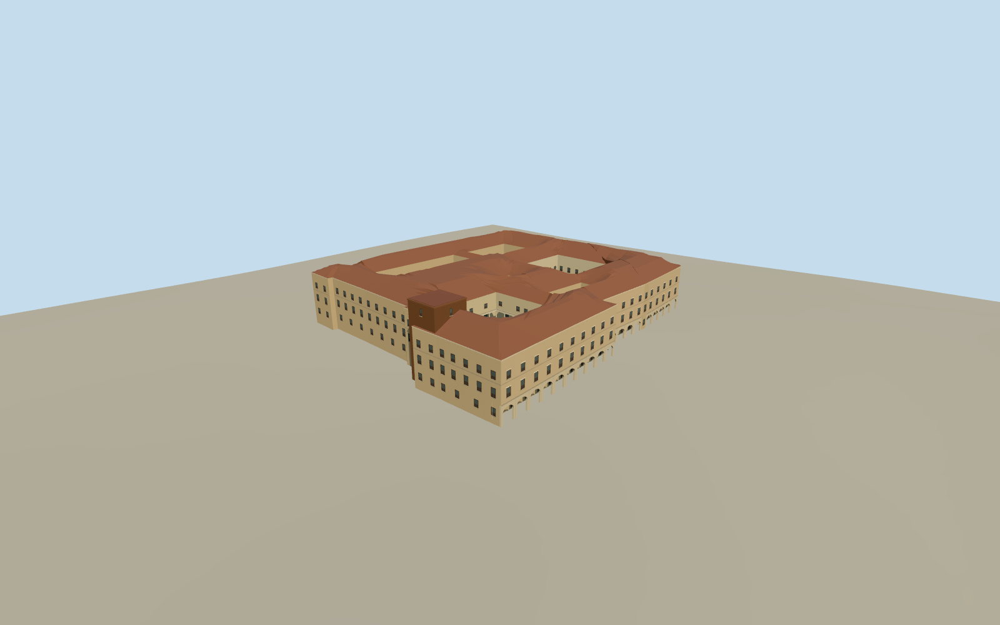

# Palazzo del Bo

Palazzo del Bo in Padua, with its western street portico, terracotta roofs, two principal courtyards and the six-tier anatomical theatre.

Authoring state: **review-in-qa.json**. Current completion evidence is in [qa.json](qa.json) and the [completion ledger](../../../../qualla-structures/batches/qualla-003.PROGRESS.md).

- [Anatomical Theatre of Padua](https://qualla.com/anatomical-theatre-of-padua/)

The preserved complex is represented circa 2024 with the two principal courtyards, six mapped court openings, the shortened tower and the anatomical theatre.

The named building relation and mapped tower establish the plan, the courtyard photograph establishes the double loggia, and the university gives the theatre’s six tiers and 2.97–7.56 m span range. Roof junctions, height, facades and smaller court details are approximations.

The theatre room position, tier rise, fine age-worn ornament and interior walls are estimates. Renaissance coats of arms are represented by relief shapes without specific insignia.

The original terrain is unmodified. Entrance thresholds and precise court grade remain approximate.

Build: `node content/worldgen/source/places/u2/u20/palazzo_del_bo/models/generate-palazzo-del-bo.mjs`. Add `--check` to verify exact regeneration. 46020 triangles; 6 materials; no embedded photographs.
