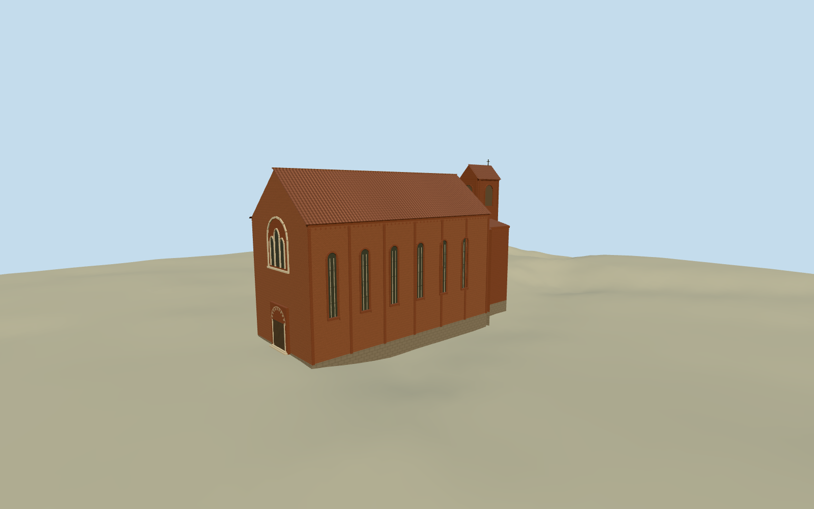

# Scrovegni Chapel

The standing medieval brick chapel and its west trifora, six-window south wall, polygonal apse, belfry and north sacristy.

Authoring state: **review-in-qa.json**. Current completion evidence is in [qa.json](qa.json) and the [completion ledger](../../../../qualla-structures/batches/qualla-004.PROGRESS.md).

- [Scrovegni Chapel](https://qualla.com/scrovegni-chapel/)

Visible exterior only. The frescoed interior, separate Roman arena, removed portico and palace, and unrelated visitor buildings are outside the model scope.

Intermediate heights, brick colors, west window stone tracery, belfry fittings and small sacristy details are approximations. No historically conjectural portico or exterior frescoes are reconstructed.

Build: `node content/worldgen/source/places/u2/u20/scrovegni_chapel/models/generate-scrovegni-chapel.mjs`. Add `--check` to verify exact regeneration. 3197 triangles; 7 materials; no embedded photographs.
